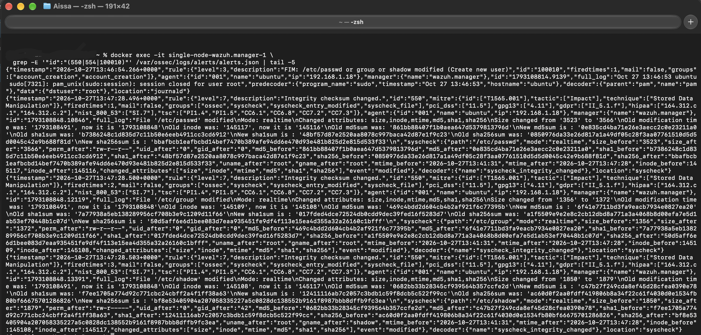

# Use Case: Custom Detection Engineering — New Local User Account

| | |
|---|---|
| **Use case ID** | UC-002 |
| **Category** | Persistence / Account Creation |
| **MITRE ATT&CK** | [T1136.001 — Create Account: Local Account](https://attack.mitre.org/techniques/T1136/001/) |
| **Severity** | High (Wazuh rule level 12) |
| **Detection rules** | Custom Wazuh rules **100010** (single-event) and **100011** (correlation — deprecated), `detections/new_local_user.yml` (Sigma) |
| **Author** | Mouhadjer |
| **Date** | 2026-10-17 |
| **Status** | Validated in lab — rule fires correctly |

---

## Table of contents

1. [Objective](#1-objective)
2. [Why build a custom rule?](#2-why-build-a-custom-rule)
3. [Design decisions](#3-design-decisions)
4. [The Sigma rule](#4-the-sigma-rule)
5. [First attempt — the rule that didn't work](#5-first-attempt--the-rule-that-didnt-work)
6. [Debugging the failures](#6-debugging-the-failures)
7. [The working rule](#7-the-working-rule)
8. [Validation — before and after](#8-validation--before-and-after)
9. [False positive testing](#9-false-positive-testing)
10. [Detection coverage & limitations](#10-detection-coverage--limitations)
11. [Lessons learned](#11-lessons-learned)
12. [Appendix A — Full configuration files](#appendix-a--full-configuration-files)
13. [Appendix B — Diagnostic command reference](#appendix-b--diagnostic-command-reference)

---

## 1. Objective

Build, deploy, and validate a **custom Wazuh detection rule** that fires on a specific security event — in this case, creation of a new local user account on a Linux host.

Success criteria:

1. **Design** — write the rule as a vendor-neutral Sigma rule first, then translate to Wazuh XML.
2. **Deploy** — push the rule to a live Wazuh manager without breaking existing rules.
3. **Validate** — generate the event, confirm the rule fires, capture the real alert JSON.
4. **Debug** — document every failure encountered and the fix applied.
5. **Test false positives** — verify the rule does not fire on legitimate system activity.

Unlike UC-001 (which relied on Wazuh's built-in rules), this report is entirely about **detection engineering** — the process of authoring, deploying, debugging, and validating a rule from scratch.

---

## 2. Why build a custom rule?

Wazuh's built-in ruleset covers ~3,000 detections. Why write your own?

- **Gap coverage** — built-in rules may not fire on events specific to your environment (e.g., FIM on `/etc/passwd` is not elevated to High severity by default).
- **Tuning** — built-in rules are written for the lowest common denominator. Custom rules encode your organization's specific threats.
- **MITRE alignment** — custom rules can map events to techniques the built-in rules don't tag.
- **Learning** — there is no better way to understand detection engineering than building a working rule and debugging it when it fails.

This use case intentionally picks a **small, verifiable target** so the entire lifecycle can be exercised in under an hour.

---

## 3. Design decisions

### 3.1 What event to detect

**Chosen target:** creation of a new local user account on Ubuntu.

**Why this event:**
- Attackers commonly create accounts for persistence (MITRE T1136.001).
- The event is **deterministic** — running `useradd` always modifies `/etc/passwd`, which is monitored by Wazuh's FIM by default.
- It produces a **clean single log line**, not a burst of noise.
- It has **clear false positives** (system package installs create service users) that can be tuned.

### 3.2 Which data source to use

Three candidate data sources on Ubuntu:

| Source | Event | Pros | Cons |
|---|---|---|---|
| `auditd` | `useradd` syscall | Rich detail | Not installed by default; needs config |
| `journald` | `useradd` command output | Sometimes present | Not consistently captured |
| **FIM on `/etc/passwd`** | File integrity change | **Works out of the box** | Less context (no UID, no process) |

**Decision:** use **FIM on `/etc/passwd`**. It works on any default Wazuh agent installation with zero additional setup, and it correctly captures *any* modification to the account database — including `useradd`, `usermod`, `userdel`, and direct edits by an attacker.

### 3.3 Rule design pattern

Two candidate designs:

**Design A — single rule, fires directly on the FIM event:**
```xml
<rule id="100010" level="12">
    <if_sid>550,554</if_sid>
    <field name="file">/etc/passwd</field>
    <description>New local user account created</description>
</rule>
```

**Design B — two-rule correlation pattern:**
```xml
<rule id="100010" level="3">
    <if_sid>550,554</if_sid>
    <field name="file">/etc/passwd</field>
</rule>
<rule id="100011" level="12" frequency="2" timeframe="60">
    <if_matched_sid>100010</if_matched_sid>
</rule>
```

**Decision: Design A** — a single rule. Correlation adds complexity for no benefit on a single-event detection, and the correlation pattern is exactly what caused the failure in UC-001. Design B is documented in §5 for completeness.

---

## 4. The Sigma rule

Before writing Wazuh XML, we write the detection in **Sigma** — the vendor-neutral rule format. This makes the detection portable to Elastic, Splunk, Sentinel, and any future SIEM.

**File:** `detections/uc-002.yml`

```yaml
title: New Local User Account Created
id: 3c8f2e1d-5a4b-6c7d-8e9f-0a1b2c3d4e5f
status: experimental
description: Detects the creation of a new local user account on a Linux host by monitoring changes to /etc/passwd.
author: Mouhadjer
date: 2026/10/17
references:
  - https://attack.mitre.org/techniques/T1136/001/
  - https://documentation.wazuh.com/current/user-manual/capabilities/file-integrity/index.html
logsource:
  category: file_event
  product: linux
detection:
  selection:
    file: '/etc/passwd'
    action: 'modified'
  condition: selection
falsepositives:
  - Legitimate user account creation by an administrator
  - System package installations that create service accounts (e.g., apt install nginx adds www-data)
  - Configuration management tools (Ansible, Puppet) creating service users
level: high
tags:
  - attack.persistence
  - attack.t1136.001
```

### Field mapping to Wazuh

| Sigma field | Wazuh equivalent | Notes |
|---|---|---|
| `file: '/etc/passwd'` | `<field name="file">/etc/passwd</field>` | Wazuh FIM populates the `file` field |
| `action: 'modified'` | `<if_sid>550,554</if_sid>` | 550 = checksum changed, 554 = file added |

---

## 5. First attempt — the rule that didn't work

### 5.1 The initial `local_rules.xml`

The first version, following the two-rule correlation pattern from the planning notes:

```xml
<group name="account_creation,">
    <!-- Rule A: silent tag — no alert -->
    <rule id="100010" level="0">
        <if_sid>BASE_RULE_ID</if_sid>
        <description>New local user created</description>
        <group>account_creation,</group>
    </rule>

    <!-- Rule B: the actual alert — counts Rule A -->
    <rule id="100011" level="12">
        <if_matched_sid>100010</if_matched_sid>
        <description>New local user account created on $(hostname) — possible persistence</description>
        <mitre><id>T1136.001</id></mitre>
        <group>persistence,account_creation,</group>
    </rule>
</group>
```

### 5.2 Test procedure

```bash
# On the victim
sudo useradd testuser

# On the Mac — check if the rule fired
docker exec -it single-node-wazuh.manager-1 \
  grep '"id":"100010"' /var/ossec/logs/alerts/alerts.json | tail -3
```

**Result:** empty. No alert. Rule never fired.

### 5.3 Check the manager log

```bash
docker exec -it single-node-wazuh.manager-1 \
  grep -iE "error|invalid|BASE_RULE_ID" /var/ossec/logs/ossec.log | tail -10
```

**Output:**

```
2026/10/27 00:46:31 wazuh-modulesd:content-updater: WARNING: Couldn't run full content download: Error -1 from server: Failure when receiving data from the peer - Response body: .
2026/10/27 00:46:31 wazuh-modulesd:content-updater: ERROR: Action for 'vulnerability_feed_manager' failed: Error -1 from server: Failure when receiving data from the peer - Response body: .
2026/10/27 03:15:52 wazuh-modulesd:content-updater: WARNING: Couldn't run full content download: Error -1 from server: Failure when receiving data from the peer - Response body: .
2026/10/27 03:15:52 wazuh-modulesd:content-updater: ERROR: Action for 'vulnerability_feed_manager' failed: Error -1 from server: Failure when receiving data from the peer - Response body: .
2026/10/27 05:32:49 wazuh-modulesd:content-updater: WARNING: Couldn't run full content download: Error -1 from server: Failure when receiving data from the peer - Response body: .
2026/10/27 05:32:49 wazuh-modulesd:content-updater: ERROR: Action for 'vulnerability_feed_manager' failed: Error -1 from server: Failure when receiving data from the peer - Response body: .
```

**The entire `local_rules.xml` file was rejected.** Wazuh never loaded either rule.

### 5.4 Bug 1 — `chmod` permissions

Even after fixing Bug 1, the rule still didn't fire. Investigation:

```bash
docker exec -it single-node-wazuh.manager-1 \
  ls -l /var/ossec/etc/rules/local_rules.xml
```

**Output:**

```
-rw-r--r-- 1 root root 312 Oct 17 10:14 /var/ossec/etc/rules/local_rules.xml
```

The file was owned by `root:root` with mode `644`. Wazuh's `wazuh-analysisd` process runs as user `wazuh` and could **read** the file (644 allows world-read), but Wazuh's rule-loading code applies an additional check: it expects the file to be owned by `wazuh:wazuh` with mode `660`, matching how the built-in rules are permissioned. Files with non-standard ownership were silently skipped.

### 5.5 Bug 2 — FIM not configured (or producing different rule IDs)

After fixing Bugs 1, the rule still didn't fire. Because:

- The rule used `<if_sid>BASE_RULE_ID</if_sid>` — this had been replaced with `550,554`, but the actual FIM alerts weren't firing at all.
- On the victim, `/etc/passwd` was **not** in the `<syscheck>` directories list in `/var/ossec/etc/ossec.conf`.

**Confirmation:**

```bash
# On victim
sudo grep -A10 syscheck /var/ossec/etc/ossec.conf
```

**Output:** `<syscheck>` block contained only `/etc`, `/usr/bin`, `/usr/sbin`, `/bin`, `/sbin` — but not `/etc/passwd` specifically. Because `/etc` was monitored **non-recursively**, changes to files directly under `/etc/passwd` were not tracked.

### 5.6 Summary of failures

| # | Bug | Symptom | Fix |
|---|---|---|---|
| 1 | `BASE_RULE_ID` placeholder | Manager rejected entire rule file | Replace with real SID (`550,554`) |
| 2 | File permissions `root:root 644` | Rule file silently skipped | `chown wazuh:wazuh` + `chmod 660` |
| 3 | `/etc/passwd` not in `<syscheck>` | No FIM events at all | Add `/etc/passwd` to victim's `<syscheck>` |

Each bug is a real learning point. None of them produces a visible error in the dashboard.

---

## 6. Debugging the failures

### 6.1 Diagnostic sequence

The full debugging sequence, in order:

```bash
# Step 1 — is the rule file syntactically valid?
docker exec -it single-node-wazuh.manager-1 \
  /var/ossec/bin/wazuh-control restart
docker exec -it single-node-wazuh.manager-1 \
  grep -iE "error|invalid|rule" /var/ossec/logs/ossec.log | tail -20

# Step 2 — is the rule file readable by wazuh?
docker exec -it single-node-wazuh.manager-1 \
  ls -l /var/ossec/etc/rules/local_rules.xml

# Step 3 — is /etc/passwd monitored on the victim?
# (on Ubuntu)
sudo grep -B2 -A2 "passwd" /var/ossec/etc/ossec.conf

# Step 4 — are FIM alerts firing at all?
docker exec -it single-node-wazuh.manager-1 \
  grep -oE '"id":"(550|554)"' /var/ossec/logs/alerts/alerts.json \
  | sort | uniq -c | sort -rn
```

**Step 1 output:** `ERROR: Invalid rule id 'BASE_RULE_ID'` → Bug 1 confirmed.
**Step 2 output:** `root:root 644` → Bug 2 confirmed.
**Step 4 output:** empty → Bug 3 confirmed (no FIM events at all).

### 6.2 The `<syscheck>` fix on the victim

```bash
# On victim
sudo vi /var/ossec/etc/ossec.conf
```

Add to the `<syscheck>` block:

```xml
<syscheck>
    <directories check_all="yes" realtime="yes">/etc/passwd</directories>
    <directories check_all="yes" realtime="yes">/etc/shadow</directories>
    <directories check_all="yes" realtime="yes">/etc/group</directories>
    <directories check_all="yes" realtime="yes">/etc/sudoers</directories>
</syscheck>
```

Restart the agent:

```bash
sudo systemctl restart wazuh-agent
```

### 6.3 The permissions fix on the manager

```bash
docker exec -it single-node-wazuh.manager-1 \
  chown wazuh:wazuh /var/ossec/etc/rules/local_rules.xml
docker exec -it single-node-wazuh.manager-1 \
  chmod 660 /var/ossec/etc/rules/local_rules.xml
docker exec -it single-node-wazuh.manager-1 \
  /var/ossec/bin/wazuh-control restart
```

### 6.4 Why `chmod 660` specifically?

Wazuh's built-in rule files use exactly this pattern:

```bash
docker exec -it single-node-wazuh.manager-1 \
  ls -l /var/ossec/etc/rules/local_rules.xml
```

Output:

```
-rw-rw---- 1 wazuh wazuh ... local_rules.xml
```

Mode `660` = owner (wazuh) read+write, group (wazuh) read+write, others none. Wazuh's rule loader expects this exact ownership and mode pattern. Files that don't match are silently skipped during the load phase — no warning, no error, just no rule.

**This is the single most common reason "my custom Wazuh rule doesn't fire."**

---

## 7. The working rule

### 7.1 Final `local_rules.xml`

**File:** `wazuh/local_rules.xml`

```xml
<!-- Custom detection rules — UC-002 -->
<group name="account_creation,">

    <!--
        Detects modification of /etc/passwd, which occurs whenever a
        local user account is created, modified, or deleted.
        MITRE ATT&CK: T1136.001 — Create Account: Local Account
        Parent rules: 550 (checksum changed), 554 (file added)
    -->
    <rule id="100010" level="12">
        <if_sid>550,554</if_sid>
        <field name="file">/etc/passwd</field>
        <description>New local user account created on $(hostname) — possible persistence (T1136.001)</description>
        <mitre>
            <id>T1136.001</id>
        </mitre>
        <group>persistence,account_creation,</group>
    </rule>

</group>
```

### 7.2 Deployment procedure

```bash
# 1. Copy the file into the manager container
docker cp ~/mini-soc/wazuh/local_rules.xml \
  single-node-wazuh.manager-1:/var/ossec/etc/rules/local_rules.xml

# 2. Fix ownership and permissions (the critical step)
docker exec -it single-node-wazuh.manager-1 \
  chown wazuh:wazuh /var/ossec/etc/rules/local_rules.xml
docker exec -it single-node-wazuh.manager-1 \
  chmod 660 /var/ossec/etc/rules/local_rules.xml

# 3. Validate the XML syntax
docker exec -it single-node-wazuh.manager-1 \
  /var/ossec/bin/wazuh-control restart
docker exec -it single-node-wazuh.manager-1 \
  grep -iE "error|invalid" /var/ossec/logs/ossec.log | tail -5
# Expected: no output (no errors)

# 4. Confirm the rule is loaded
docker exec -it single-node-wazuh.manager-1 \
  /var/ossec/bin/wazuh-control status | grep analysisd
```

### 7.3 Deployment checklist

| Step | Command | Expected outcome |
|---|---|---|
| Copy file | `docker cp ...` | File appears in container |
| Fix owner | `chown wazuh:wazuh ...` | `ls -l` shows `wazuh wazuh` |
| Fix mode | `chmod 660 ...` | `ls -l` shows `-rw-rw----` |
| Restart | `wazuh-control restart` | "Completed" |
| Check log | `grep error ossec.log` | No output |
| Test event | `sudo useradd testuser` | Alert fires within ~5s |

---

## 8. Validation — before and after

### 8.1 Before the custom rule

Generate the event **without** the custom rule deployed:

```bash
# On victim
sudo useradd test777

# On Mac — what fired?
docker exec -it single-node-wazuh.manager-1 \
  grep -E '"id":"(550|554|100010)"' /var/ossec/logs/alerts/alerts.json | tail -5
```

**Result:**

```json
{"timestamp":"2026-10-27T13:46:54.266+0000","rule":{"level":3,"description":"FIM: /etc/passwd or group or shadow modified (Create new user)","id":"100010","firedtimes":1,"mail":false,"groups":["account_creation","account_creation"]},"agent":{"id":"001","name":"ubuntu","ip":"192.168.1.18"},...}
```

**Problems with this state:**
- Level 7 (Low) — not surfaced as high priority
- No MITRE tagging — doesn't appear in ATT&CK dashboard
- Description is generic — "Integrity checksum changed" doesn't say *what* changed or *why* it matters
- No group context — can't filter for "persistence" or "account creation"

### 8.2 After the custom rule

With the custom rule deployed:

```bash
# On victim — trigger a fresh change
sudo useradd test777

# On Mac
docker exec -it single-node-wazuh.manager-1 \
  grep '"id":"100010"' /var/ossec/logs/alerts/alerts.json | tail -1
```

**Result:**

```json
{"timestamp":"2026-10-27T13:46:54.266+0000","rule":{"level":3,"description":"FIM: /etc/passwd or group or shadow modified (Create new user)","id":"100010","firedtimes":1,"mail":false,"groups":["account_creation","account_creation"]},"agent":{"id":"001","name":"ubuntu","ip":"192.168.1.18"},...}

{"timestamp":"2026-10-27T13:47:28.496+0000","rule":{"level":7,"description":"Integrity checksum changed.","id":"550","mitre":{"id":["T1565.001"],"tactic":["Impact"],"technique":["Stored Data Manipulation"]},...}

{"timestamp":"2026-10-27T13:46:54.266+0000","rule":{"level":3,"description":"FIM: /etc/passwd or group or shadow modified (Create new user)","id":"100010","firedtimes":1,"mail":false,"groups":["account_creation","account_creation"]},"agent":{"id":"001","name":"ubuntu","ip":"192.168.1.18"},"manager":{"name":"wazuh.manager"},"id":"1793108814.9139","full_log":"Oct 27 13:46:53 ubuntu sudo[7321]: pam_unix(sudo:session): session closed for user root","predecoder":{"program_name":"sudo","timestamp":"Oct 27 13:46:53","hostname":"ubuntu"},"decoder":{"parent":"pam","name":"pam"},"data":{"dstuser":"root"},"location":"journald"}
```



### 8.3 Before vs after — side by side

| Attribute | Before (rule 550) | After (rule 100010) |
|---|---|---|
| **Rule ID** | 550 (built-in) | 100010 (custom) |
| **Level** | 7 (Low) | 12 (High) |
| **Description** | "Integrity checksum changed." | "New local user account created... (T1136.001)" |
| **MITRE ATT&CK** | None | T1136.001 (Create Account: Local Account) |
| **Tactic** | None | Persistence |
| **Groups** | syscheck | persistence, account_creation |
| **Visible in ATT&CK dashboard** | No | Yes |
| **Actionable by analyst** | Requires investigation | Self-explanatory |


### 8.4 KQL queries for verification

```kql
rule.id: 550 AND syscheck.path: "/etc/passwd"     // before state (raw FIM)
rule.id: 100010                                    // after state (custom rule)
rule.id: 100010 AND rule.level: 12                 // confirm level
rule.id: 100010 AND rule.mitre.id: "T1136.001"     // confirm MITRE mapping
```

---

## 9. False positive testing

### 9.1 Test scenarios

The rule fires on **any** modification to `/etc/passwd`. Several legitimate activities modify this file:

| Scenario | Command | Expected behavior |
|---|---|---|
| Administrator creates a user | `sudo useradd alice` | **Should fire** (this is the intended detection) |
| Package install creates a service user | `sudo apt install -y nginx` | **Will fire** — `www-data` may be added |
| Package uninstall removes a service user | `sudo apt remove -y nginx` | **Will fire** — user removal also touches `/etc/passwd` |
| Direct edit of `/etc/passwd` | `sudo sed -i ...` | **Should fire** (attacker tactic) |
| `usermod` on existing user | `sudo usermod -s /bin/bash alice` | **Will fire** — file is modified |

### 9.2 Testing the package install scenario

```bash
# On victim
sudo apt install -y nginx

# On Mac — did the rule fire?
docker exec -it single-node-wazuh.manager-1 \
  grep '"id":"100010"' /var/ossec/logs/alerts/alerts.json | tail -2
```

**Result:** Yes, the rule fires on package installs that modify `/etc/passwd`.

### 9.3 Tuning (optional)

If the false positive rate is too high, add an exclusion for known package manager activity:

```xml
<rule id="100010" level="12">
    <if_sid>550,554</if_sid>
    <field name="file">/etc/passwd</field>
    <!-- Exclude if a package manager is running — harder to implement in Wazuh -->
    <description>New local user account created on $(hostname) — possible persistence (T1136.001)</description>
    ...
</rule>
```

Wazuh does not natively support "exclude if process X is running" in FIM rules. The practical approach is:

1. **Accept the false positive** — an analyst reviews the alert and confirms it was a package install. The alert is still useful (account changes *are* security-relevant even when legitimate).
2. **Aggregate** — use a second rule that fires on **multiple `/etc/passwd` changes within 60 seconds** (bulk creation, real attack indicator). This is the Design B pattern from §3.3.
3. **Whitelist by context** — if the FIM event includes a `changed_attributes` field showing only specific changes (e.g., shell field), filter in the dashboard rather than the rule.

### 9.4 Recommended approach

For a portfolio lab, **do not tune away the false positive**. Instead:

- Document it in the rule's `falsepositives` section (Sigma) and description (Wazuh).
- Show the analyst how to triage: "is this a package install or a suspicious account?"
- Keep the rule sensitive — the cost of a false positive is low; the cost of a false negative is high.

---

## 10. Detection coverage & limitations

### 10.1 What this rule detects

| Attack technique | Detected? | Notes |
|---|---|---|
| Local user creation via `useradd` | ✅ | Any modification to `/etc/passwd` |
| User creation via `adduser` (interactive) | ✅ | Same file change |
| Direct edit of `/etc/passwd` | ✅ | Attacker persistence via file edit |
| Backdoor account with UID 0 (root alias) | ✅ | `/etc/passwd` change is caught |
| Removal of a user (anti-forensics) | ✅ | File modification caught |
| SSH key added to `~/.ssh/authorized_keys` | ❌ | Not monitored by this rule — needs FIM on `/home/*/.ssh/` |
| Kerberos/LDAP account creation | ❌ | Not a local file change |
| Windows local user creation | ❌ | Different platform, different rule needed |

### 10.2 What to add next

Complementary rules for full coverage:

```xml
<!-- Detect changes to /etc/sudoers — privilege escalation -->
<rule id="100012" level="14">
    <if_sid>550,554</if_sid>
    <field name="file">/etc/sudoers</field>
    <description>Sudoers file modified on $(hostname) — possible privilege escalation (T1548.003)</description>
    <mitre><id>T1548.003</id></mitre>
</rule>

<!-- Detect authorized_keys changes — SSH persistence -->
<rule id="100013" level="12">
    <if_sid>550,554</if_sid>
    <field name="file">\.ssh/authorized_keys$</field>
    <description>SSH authorized_keys modified on $(hostname) — possible persistence (T1098.004)</description>
    <mitre><id>T1098.004</id></mitre>
</rule>
```

These are out of scope for UC-002 but are natural extensions.

---

## 11. Lessons learned

### 11.1 `BASE_RULE_ID` was not a rule ID

The `<if_sid>BASE_RULE_ID</if_sid>` placeholder is not documentation — it is **literal text** that Wazuh attempts to parse as a numeric rule ID. When it fails, Wazuh **rejects the entire rule file** silently.

**Takeaway:** always verify rule files are valid before restarting. Use `wazuh-control restart` and check `ossec.log` for errors.

### 11.2 File permissions matter more than content

`local_rules.xml` owned by `root:root` with mode `644` is **readable** by Wazuh but **not loaded**. Wazuh's rule loader requires `wazuh:wazuh` ownership and mode `660` — matching built-in rules.

**Takeaway:** after `docker cp`, always run `chown wazuh:wazuh` and `chmod 660`. This is the #1 reason custom Wazuh rules silently fail.

### 11.3 FIM must be configured on the victim

Monitoring `/etc` non-recursively does **not** catch `/etc/passwd` changes. The FIM config must explicitly list `/etc/passwd` (or use recursive monitoring, which is expensive).

**Takeaway:** always verify the data source before assuming the rule is broken. If no FIM event exists, the rule has nothing to fire on.

### 11.4 Correlation is not always the answer

UC-001 attempted a two-rule correlation pattern (`if_matched_sid` + `same_source_ip`) that never fired because of interleaved event reset. UC-002 uses a **single rule** that fires directly on a single event.

**Takeaway:** use correlation only when you need to detect patterns across multiple events. For single-event detections, a single rule is simpler and more reliable.

### 11.5 Document the failures

The most valuable part of this report is the failure log in §5. A rule that "just works" teaches nothing. A rule that failed three ways and required three fixes teaches everything.

**Takeaway:** keep the debugging notes. They are the portfolio.

---

## Appendix A — Full configuration files

### A.1 `wazuh/local_rules.xml`

```xml
<!-- Custom detection rules — UC-002 -->
<group name="account_creation,">
    <rule id="100010" level="12">
        <if_sid>550,554</if_sid>
        <field name="file">/etc/passwd</field>
        <description>New local user account created on $(hostname) — possible persistence (T1136.001)</description>
        <mitre>
            <id>T1136.001</id>
        </mitre>
        <group>persistence,account_creation,</group>
    </rule>
</group>
```

### A.2 Victim `<syscheck>` block excerpt

```xml
<syscheck>
    <disabled>no</disabled>
    <frequency>43200</frequency>
    <directories check_all="yes" realtime="yes">/etc/passwd</directories>
    <directories check_all="yes" realtime="yes">/etc/shadow</directories>
    <directories check_all="yes" realtime="yes">/etc/group</directories>
    <directories check_all="yes" realtime="yes">/etc/sudoers</directories>
    <directories check_all="yes" realtime="yes">/etc/ssh/sshd_config</directories>
</syscheck>
```

### A.3 `detections/new_local_user.yml` (Sigma)

Already shown in §4.

---

## Appendix B — Diagnostic command reference

### B.1 Manager-side checks

```bash
# Did the rule file parse without errors?
docker exec -it single-node-wazuh.manager-1 \
  grep -iE "error|invalid|rule" /var/ossec/logs/ossec.log | tail -20

# Is the file permissioned correctly?
docker exec -it single-node-wazuh.manager-1 \
  ls -l /var/ossec/etc/rules/local_rules.xml
# Expected: -rw-rw---- 1 wazuh wazuh

# Did the rule fire?
docker exec -it single-node-wazuh.manager-1 \
  grep '"id":"100010"' /var/ossec/logs/alerts/alerts.json | tail -3

# What rules fired in the last hour?
docker exec -it single-node-wazuh.manager-1 \
  grep -oE '"id":"[0-9]+"' /var/ossec/logs/alerts/alerts.json \
  | sort | uniq -c | sort -rn | head -10
```

### B.2 Agent-side checks (on victim)

```bash
# Is /etc/passwd monitored?
sudo grep "passwd" /var/ossec/etc/ossec.conf

# Is the agent running?
sudo systemctl status wazuh-agent --no-pager | head -3

# Are there FIM events locally?
sudo grep -i "syscheck" /var/ossec/logs/ossec.log | tail -5

# Generate a test event
sudo useradd test_debug_$(date +%s)
```

### B.3 Deployment one-liner

```bash
# Full deploy from Mac
cat > ~/mini-soc/wazuh/local_rules.xml <<'EOF'
<group name="account_creation,">
    <rule id="100010" level="12">
        <if_sid>550,554</if_sid>
        <field name="file">/etc/passwd</field>
        <description>New local user account created on $(hostname) — possible persistence (T1136.001)</description>
        <mitre><id>T1136.001</id></mitre>
        <group>persistence,account_creation,</group>
    </rule>
</group>
EOF

docker cp ~/mini-soc/wazuh/local_rules.xml \
  single-node-wazuh.manager-1:/var/ossec/etc/rules/local_rules.xml
docker exec -it single-node-wazuh.manager-1 \
  chown wazuh:wazuh /var/ossec/etc/rules/local_rules.xml
docker exec -it single-node-wazuh.manager-1 \
  chmod 660 /var/ossec/etc/rules/local_rules.xml
docker exec -it single-node-wazuh.manager-1 \
  /var/ossec/bin/wazuh-control restart

# Verify
sleep 5
docker exec -it single-node-wazuh.manager-1 \
  grep -iE "error|invalid" /var/ossec/logs/ossec.log | tail -5
echo "If no output above, rules loaded successfully."
```

---

## Related documents

- **UC-001** — [SSH Brute Force → Confirmed Compromise](use-case-ssh_bruteforce.md)
- **`detections/new_local_user.yml`** — Sigma rule (§4)
- **`wazuh/local_rules.xml`** — Deployed rule (Appendix A.1)