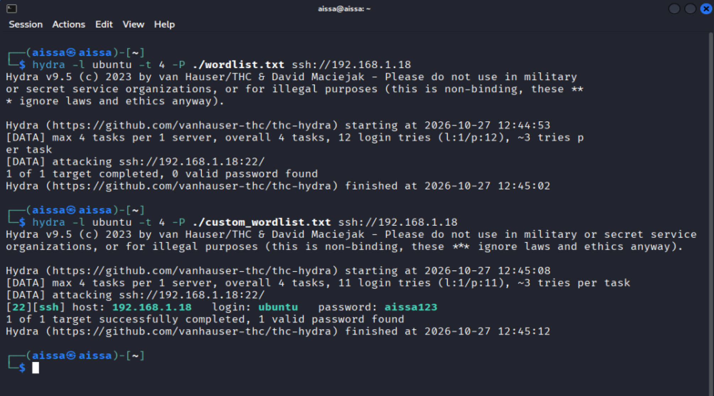
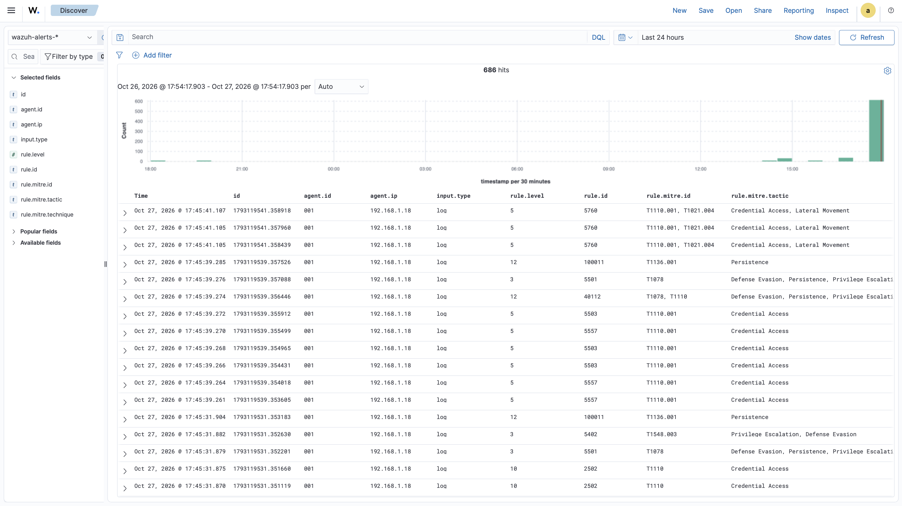
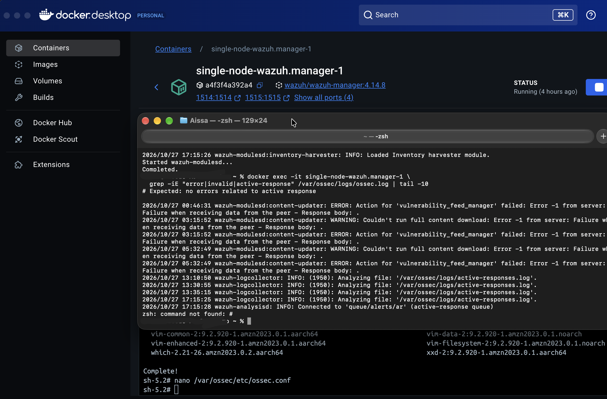
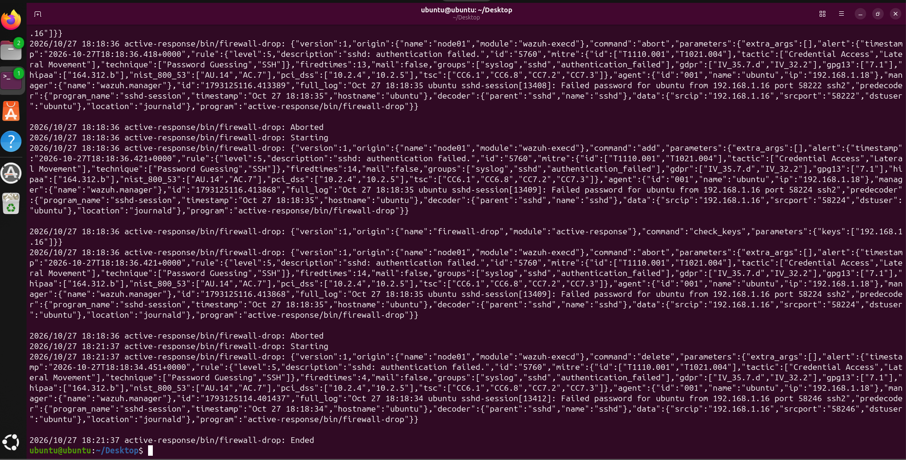
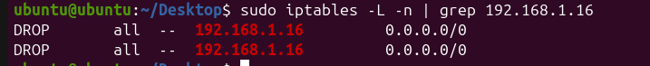
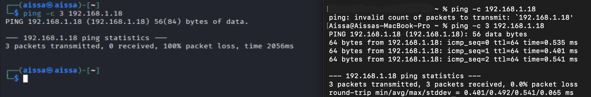
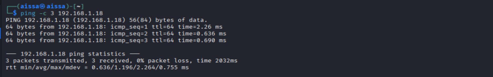

# Use Case: Active Response — Auto-Block SSH Brute-Force Source IPs

| | |
|---|---|
| **Use case ID** | UC-003 |
| **Category** | Response / Network Isolation |
| **MITRE ATT&CK** | [T1110](https://attack.mitre.org/techniques/T1110/) (Brute Force) → Response: Network Isolation |
| **Severity** | High (Wazuh rules 5710, 5760, 5763, 40111, 40112) |
| **Detection rules** | Wazuh built-in: **5710**, **5760**, **5763**, **40111**, **40112** |
| **Active response command** | `firewall-drop` (iptables DROP on attacker source IP) |
| **Block duration** | 180 seconds (automatic unblock via timeout) |
| **Author** | Mouhadjer |
| **Date** | 2026-10-27 |
| **Status** | Validated in lab — auto-block confirmed |

---

## Table of contents

1. [Objective](#1-objective)
2. [Lab architecture & inventory](#2-lab-architecture--inventory)
3. [Prerequisites & setup](#3-prerequisites--setup)
4. [Pre-Active Response Baseline](#4-pre-active-response-baseline)
5. [Configuration Steps](#5-configuration-steps)
6. [Post-Active Response Validation](#6-post-active-response-validation)
7. [Evidence & Analysis](#7-evidence--analysis)
8. [Risk Warnings](#8-risk-warnings)
9. [MTTD / MTTR](#9-mttd--mttr)
10. [Detection coverage & limitations](#10-detection-coverage--limitations)
11. [Known evasions](#11-known-evasions)
12. [Cleanup / reset the lab](#12-cleanup--reset-the-lab)
13. [Appendix A — Command reference](#appendix-a--command-reference)
14. [Appendix B — Configuration files](#appendix-b--configuration-files)
15. [Related documents](#related-documents)

---

## 1. Objective

Demonstrate **automated active response** inside the mini-SOC lab: when Wazuh detects an SSH brute-force attack, it should automatically block the attacker's source IP at the firewall (iptables DROP rule) without manual analyst intervention, then automatically unblock after a configured timeout.

This use case extends UC-001 (SSH Brute Force → Confirmed Compromise). UC-001 showed that Wazuh *alerts* on brute force but does not *respond*. UC-003 adds the response layer: detection → automatic containment.

Success criteria:

1. **Baseline** — run a Hydra SSH brute force; confirm Wazuh fires rules 5710/5760/5763/40111 but the attacker IP is **not** blocked (no active response).
2. **Configure** — deploy the `firewall-drop` active response command on the Wazuh manager and bind it to high-confidence brute-force rules.
3. **Validate** — run Hydra again; confirm Wazuh executes `firewall-drop`, adds an iptables DROP rule on the victim, and the attacker's SSH/ping is rejected.
4. **Auto-unblock** — wait 180 seconds and confirm the DROP rule is removed automatically.
5. **Risk review** — document false-positive risks and tuning guidance.

All activity is confined to an isolated local network `192.168.1.0/24`. No external systems are targeted.

---

## 2. Lab architecture & inventory

```
        ┌──────────────────────────────────────────────────────────┐
        │  Dashboard host — MacBook (SOC analyst workstation)      │
        │  Docker Compose: wazuh.manager, wazuh.indexer,           │
        │                  wazuh.dashboard (https://localhost)     │
        │  192.168.1.5                                             │
        └────────────▲──────────────────────────▲──────────────────┘
                     │ 1514/tcp (agent events)    │ 443/tcp (analyst UI)
                     │                            │
    ┌────────────────┴──────────┐   ┌───────────────┴──────────────┐
    │ Victim — Ubuntu 24.04     │   │ Attacker — Kali Linux        │
    │ Wazuh agent (id 001)      │   │ hydra, sshpass, nmap         │
    │ 192.168.1.18  sshd :22    │◄──┤ 192.168.1.16                 │
    │ iptables (firewall-drop)  │   └──────────────────────────────┘
    └───────────────────────────┘
```

| Role | Host / OS | IP | Software | Screenshot prefix |
|---|---|---|---|---|
| Dashboard host (SOC) | MacBook (macOS) | `192.168.1.5` | Wazuh manager + indexer + dashboard **(Docker Compose)** | `wazuh-*.png` |
| Victim | Ubuntu 24.04 VM, agent **001** (`ubuntu`) | `192.168.1.18` | `openssh-server`, `wazuh-agent`, `iptables` | `ubuntu-*.png` |
| Attacker | Kali Linux VM | `192.168.1.16` | `hydra`, `sshpass`, `nmap` | `kali-*.png` |

**Lab assumptions:**

- Wazuh agent on the victim is enrolled against `192.168.1.5:1515` and reports as agent ID 001, name `ubuntu`.
- Wazuh dashboard is reached from the Mac at `https://localhost` (compose maps `443 → 5601`), credentials `admin / SecretPassword`.
- Agent logs are forwarded via **journald** (Ubuntu 24.04 sshd logs to journald by default).
- The `firewall-drop` active response script exists on the Wazuh manager and is configured to run on the victim agent.

---

## 3. Prerequisites & setup

### 3.1 Dashboard host — deploy the Wazuh stack

```bash
git clone https://github.com/wazuh/wazuh-docker.git -b v4.14.8
cd wazuh-docker/single-node/
docker compose up -d
docker compose ps          # all three containers should be "running"
open https://localhost     # Wazuh dashboard (admin / SecretPassword)
```

Confirm the manager is healthy:

```bash
docker exec -it single-node-wazuh.manager-1 \
  /var/ossec/bin/wazuh-control status
```

### 3.2 Enroll the Ubuntu victim agent

On the victim (`192.168.1.18`):

```bash
# Download and run the agent enrollment script
curl -sO https://packages.wazuh.com/4.x/apt/pool/main/w/wazuh-agent/wazuh-agent_4.14.8-1_amd64.deb
sudo WAZUH_MANAGER="192.168.1.5" dpkg -i ./wazuh-agent_4.14.8-1_amd64.deb
sudo systemctl daemon-reload
sudo systemctl enable wazuh-agent
sudo systemctl start wazuh-agent
```

On the manager, confirm the agent appears:

```bash
docker exec -it single-node-wazuh.manager-1 \
  /var/ossec/bin/agent_manage -L
# Expected: agent 001 "ubuntu" listed as "Active"
```

### 3.3 Verify `firewall-drop` script exists on the manager

```bash
docker exec -it single-node-wazuh.manager-1 \
  ls -l /var/ossec/active-response/bin/firewall-drop
# Expected: -rwxr-xr-x 1 root root ... firewall-drop
```

---

## 4. Pre-Active Response Baseline

Before configuring active response, establish the baseline: Wazuh **alerts** on SSH brute force but does **not** block the attacker. This proves that detection and response are separate layers.

### 4.1 Run the Hydra attack (baseline)

From the Kali attacker (`192.168.1.16`):

```bash
# Phase 1 — invalid-user enumeration
hydra -l testuser -P /usr/share/wordlists/rockyou.txt ssh://192.168.1.18

# Phase 2 — valid-user brute force
hydra -l ubuntu -P /usr/share/wordlists/rockyou.txt ssh://192.168.1.18
```

### 4.2 Observe Wazuh alerts (no block)

On the dashboard host:

```bash
docker exec -it single-node-wazuh.manager-1 \
  grep -oE '"id":"(5710|5760|5763|40111|40112)"' /var/ossec/logs/alerts/alerts.json \
  | sort | uniq -c | sort -rn
```

**Expected baseline result:** Wazuh fires rules 5710, 5760, 5763, and 40111, but:
- No `firewall-drop` execution appears in `active-responses.log`.
- No iptables DROP rule exists on the victim.
- The attacker can continue SSH attempts uninterrupted.





**Figure 2:** Wazuh dashboard showing rules 5710/5760/5763 firing during Hydra, with no active response executed. This is the pre-block baseline.

---

## 5. Configuration Steps

### 5.1 Confirm the `firewall-drop` script exists on the agent

The `firewall-drop` active response script must be present on the Wazuh manager (and distributed to agents). It adds an iptables DROP rule for the attacker's source IP:

```bash
docker exec -it single-node-wazuh.manager-1 \
  ls -l /var/ossec/active-response/bin/firewall-drop
```

The script reads the alert via stdin, extracts the source IP, and runs:

```bash
iptables -I INPUT -s <attacker-ip> -j DROP
```

### 5.2 Add `<command>` and `<active-response>` blocks to manager config

Edit `/var/ossec/etc/ossec.conf` on the Wazuh manager container:

```xml
<!-- Active response command definition -->
<command>
    <name>firewall-drop</name>
    <executable>firewall-drop.sh</executable>
    <timeout_allowed>yes</timeout_allowed>
</command>

<!-- Active response binding — trigger on brute-force rules -->
<active-response>
    <command>firewall-drop</command>
    <location>local</location>
    <rules_id>5710,5760,5763,40111,40112</rules_id>
    <repeated_offenders>30,60,120</repeated_offenders>
    <timeout>180</timeout>
</active-response>
```

Key fields:

| Field | Value | Meaning |
|---|---|---|
| `<command>` | `firewall-drop` | References the executable defined above |
| `<location>` | `local` | Runs on the agent where the event originated (the victim) |
| `<rules_id>` | `5710,5760,5763,40111,40112` | Only these high-confidence brute-force rules trigger the block |
| `<timeout>` | `180` | Block expires after 180 seconds (automatic unblock) |
| `<repeated_offenders>` | `30,60,120` | Escalating block times for repeat offenders |

> **Why bind only to 5710/5760/5763/40111/40112?** These rules have high confidence that an attack is in progress. Binding active response to low-confidence rules risks blocking legitimate users (see §8 Risk Warnings).

### 5.3 Restart the manager

```bash
docker exec -it single-node-wazuh.manager-1 \
  /var/ossec/bin/wazuh-control restart
```

Verify no errors in the manager log:

```bash
docker exec -it single-node-wazuh.manager-1 \
  grep -iE "error|invalid|active-response" /var/ossec/logs/ossec.log | tail -10
# Expected: no errors related to active response
```



**Figure 3:** Showing error logs after configuration blocks bound to rules 5710, 5760, 5763, 40111, 40112 with a 180-second timeout.

---

## 6. Post-Active Response Validation

### 6.1 Run Hydra again to trigger the block

From the Kali attacker (`192.168.1.16`):

```bash
hydra -l ubuntu -P /usr/share/wordlists/rockyou.txt ssh://192.168.1.18
```

Rule 5763 (`sshd: brute force trying to get access to the system`) should fire within seconds, triggering the `firewall-drop` active response.

### 6.2 Check `active-responses.log` for block records

On the victime:

```bash
sudo cat /var/ossec/logs/active-responses.log
```

**Expected output:** A line showing `firewall-drop` executed for the attacker IP `192.168.1.16` on agent 001.



**Figure 4:** `active-responses.log` showing the `firewall-drop` command executing against attacker IP `192.168.1.16` on the victim agent.

### 6.3 Verify iptables DROP rule on the victim

On the victim (`192.168.1.18`):

```bash
sudo iptables -L -n | grep 192.168.1.16
```

**Expected output:** A DROP rule matching `192.168.1.16` in the INPUT chain.



**Figure 5:** Victim iptables output showing the DROP rule inserted for `192.168.1.16`, blocking all inbound traffic from the attacker.

### 6.4 Confirm SSH connection is rejected from Kali

From the Kali attacker (`192.168.1.16`):

```bash
ping -c 3 192.168.1.18
# Expected: 100% packet loss
```



**Figure 6:** Kali attacker unable to SSH to the victim after the `firewall-drop` block is in effect — connection is rejected or times out.

### 6.5 Wait 180 seconds — confirm automatic unblocking

On the victim, after the 180-second timeout:

```bash
sudo iptables -L -n | grep 192.168.1.16
# Expected: no output (DROP rule removed automatically)
```

On the manager, check the active-responses.log for the unblock entry:

```bash
docker exec -it single-node-wazuh.manager-1 \
  grep -i "192.168.1.16" /var/ossec/logs/active-responses.log | tail -5
```



**Figure 7:** `active-responses.log` showing the firewall-drop command completed and the iptables DROP rule removed after the 180-second timeout.

---

## 7. Evidence & Analysis

| # | Evidence | What it proves |
|---|---|---|
| 1 | Wazuh alerts firing (rules 5710/5760/5763) without block | Baseline: detection works, response does not |
| 2 | `active-responses.log` — `firewall-drop` execution | Wazuh issued the active response command |
| 3 | Victim `iptables -L` — DROP rule for `192.168.1.16` | Block was applied at the host firewall |
| 4 | Kali SSH failure / ping timeout | Attacker is contained — cannot reach the victim |
| 5 | Automatic unblock after 180 seconds | Block is temporary; no permanent lockout |

### 7.1 Timeline of events

| Time | Event | Source |
|---|---|---|
| T+0s | Hydra SSH brute force starts | Kali → Ubuntu |
| T+~5s | Wazuh rule 5763 fires (brute force detected) | Wazuh manager |
| T+~6s | `firewall-drop` active response executes | Manager → Agent 001 |
| T+~7s | iptables DROP rule inserted for `192.168.1.16` | Victim (ubuntu) |
| T+~8s | Kali SSH connection rejected | Kali ← Ubuntu |
| T+180s | iptables DROP rule removed automatically | Victim (ubuntu) |

---

## 8. Risk Warnings (Critical)

Active response is powerful but dangerous. Misconfiguration can cause denial of service for legitimate users.

| Risk | Impact | Mitigation |
|---|---|---|
| **False positives** | Legitimate users blocked | Bind only to high-confidence rules (5710/5760/5763/40111/40112); never to low-confidence rules |
| **Shared NAT / VPN egress** | All users behind a shared IP blocked | Exclude known NAT/VPN egress IPs from active response |
| **Monitoring systems blocked** | Wazuh manager itself could lose agent connectivity | Whitelist the manager IP and monitoring probe IPs |
| **Permanent lockout** | Administrator locked out of the victim | Always use `<timeout>` (180s) rather than permanent blocks |
| **Attacker exhaustion** | Attacker triggers block on decoy IP | Combine with rate limiting and source reputation |

**Recommendation:** Test active response in an isolated lab first, using temporary blocks (timeout) rather than permanent blocks. Start with a narrow ruleset and expand only after validating false positives are under control.

---

## 9. MTTD / MTTR

| Metric | Before active response (UC-001) | After active response (UC-003) |
|---|---|---|
| **MTTD** (Mean Time to Detect) | ~5–10 seconds (rule 5763 fires) | ~5–10 seconds (unchanged) |
| **MTTR** (Mean Time to Respond) | Manual — analyst must investigate and block | ~6 seconds (automatic firewall-drop) |
| **Containment** | None — attacker continues until manual action | Automatic — attacker IP blocked at iptables |
| **Auto-recovery** | N/A | Automatic unblock after 180 seconds |

Active response reduces MTTR from minutes/hours (manual) to seconds (automatic), while MTTD remains governed by the detection rule firing time.

---

## 10. Detection coverage & limitations

| Attack scenario | Blocked by active response? | Notes |
|---|---|---|
| SSH brute force from single IP | Yes | Rule 5763 triggers `firewall-drop` |
| SSH brute force from many IPs (distributed) | Partial | Each IP must independently cross the threshold |
| Low-and-slow (1 attempt / 5 min) | NO | Frequency threshold not met; no block |
| Valid credentials obtained elsewhere (phishing) | NO | No preceding failures — rule 5763 does not fire |
| SSH key-based auth | NO | Rules 5710/5763 target password authentication |
| Attacker already inside (post-compromise) | NO | Active response blocks new connections, not existing sessions |

---

## 11. Cleanup / reset the lab

```bash
# On Kali — remove attack artifacts
rm -f ~/hydra-ssh-*.log ~/medusa-ssh.log ~/users.txt ~/wordlist.txt
history -c && history -w

# On victim — remove any remaining iptables DROP rules
sudo iptables -D INPUT -s 192.168.1.16 -j DROP 2>/dev/null || true
sudo iptables -L -n | grep 192.168.1.16   # should return nothing

# On manager — optionally disable active response for lab reset
# (comment out the <active-response> block in ossec.conf and restart)
docker exec -it single-node-wazuh.manager-1 \
  /var/ossec/bin/wazuh-control restart
```

In the dashboard: mark the UC-003 alerts as **Closed** with a comment "lab validation UC-003 — controlled simulation, benign".

---

## Related documents

- **UC-001** — [SSH Brute Force → Confirmed Compromise](use-case-ssh_bruteforce.md)
- **UC-002** — [Custom Detection Engineering — New Local User Account](uc-002.md)
- **`wazuh/local_rules.xml`** — Deployed Wazuh rules
- **MITRE ATT&CK T1110** — [Brute Force](https://attack.mitre.org/techniques/T1110/)