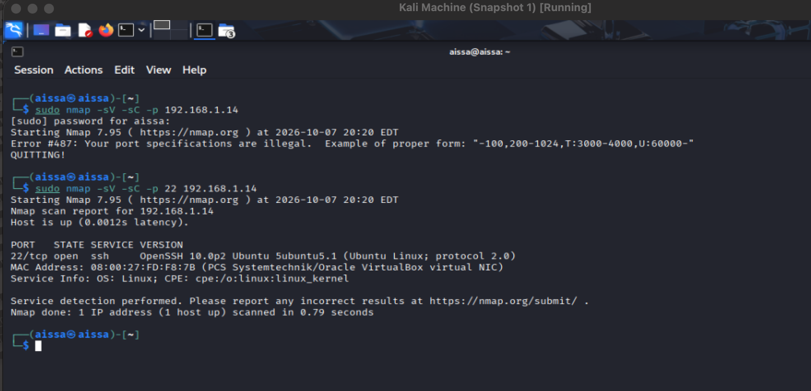
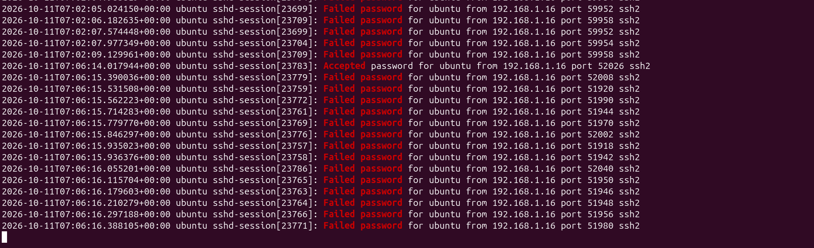
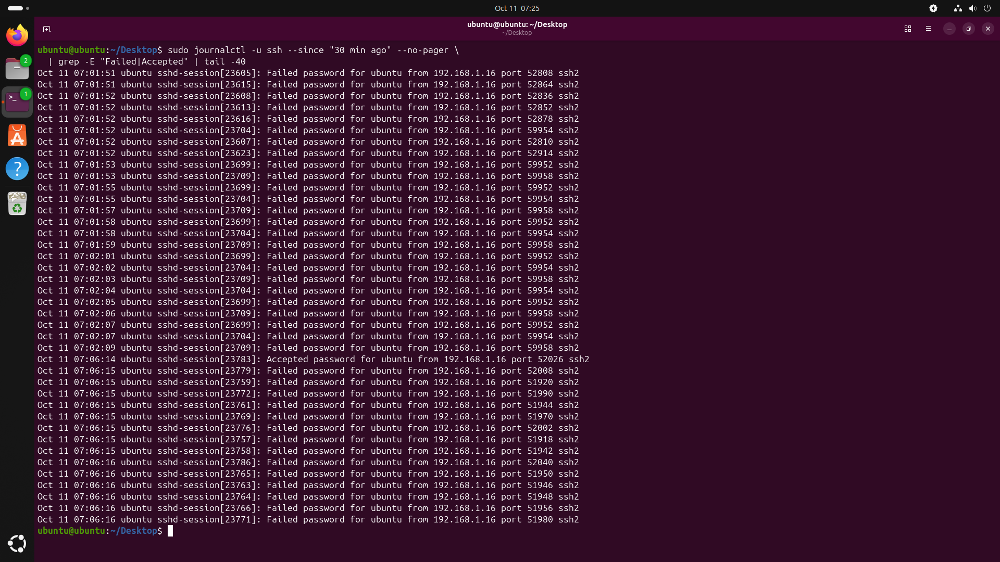

# Use Case: SSH Brute Force Detection & Response

| | |
|---|---|
| **Use case ID** | UC-001 |
| **Category** | Credential Access / Brute Force |
| **MITRE ATT&CK** | [T1110.001 – Brute Force: Password Guessing](https://attack.mitre.org/techniques/T1110/001/) |
| **Severity** | Medium (Wazuh rule level 10, Sigma `level: medium`) |
| **Detection rules** | `wazuh/local_rules.xml` → rule **100001**, `detections/ssh_bruteforce.yml` (Sigma) |
| **Author** | Mouhadjer |
| **Date** | 2026-10-09 |
| **Status** | Validated in lab |

---

## Table of contents

1. [Objective](#1-objective)
2. [Lab architecture & inventory](#2-lab-architecture--inventory)
3. [Prerequisites & lab setup](#3-prerequisites--lab-setup)
4. [Detection logic](#4-detection-logic)
5. [Attack simulation (attacker VM – Kali Linux)](#5-attack-simulation-attacker-vm--kali-linux)
6. [Screenshot capture checklist](#6-screenshot-capture-checklist)
7. [Evidence on the victim VM (Ubuntu agent)](#7-evidence-on-the-victim-vm-ubuntu-agent)
8. [Log excerpt from `/var/log/auth.log`](#8-log-excerpt-from-varlogauthlog)
9. [What the analyst sees (dashboard host – Mac)](#9-what-the-analyst-sees-dashboard-host--mac)
10. [Wazuh alert excerpt](#10-wazuh-alert-excerpt)
11. [Investigation questions](#11-investigation-questions)
12. [Response actions](#12-response-actions)
13. [Detection tuning & false positives](#13-detection-tuning--false-positives)
14. [Cleanup / reset the lab](#14-cleanup--reset-the-lab)
15. [Appendix A – Command reference](#appendix-a--command-reference)

---

## 1. Objective

Demonstrate the full detection lifecycle of an SSH password brute-force attack inside the mini-SOC lab:

1. **Attack** – launch a controlled SSH brute force from the Kali attacker VM (`192.168.1.16`) against the Ubuntu victim VM (`192.168.1.14`).
2. **Detect** – show the attack appearing in the victim's `auth.log` file, being shipped by the Wazuh agent, and firing Wazuh rule **100001** in the Wazuh dashboard running on the Mac host.
3. **Triage** – extract the key facts an analyst needs: source IP, targeted accounts, attempt count/velocity, and whether any login succeeded.
4. **Respond** – apply containment and hardening actions, then reset the lab.

Everything runs on an isolated local network `192.168.1.0/24`. No external systems are scanned or attacked.

---

## 2. Lab architecture & inventory

```
        ┌──────────────────────────────────────────────────────────┐
        │  Original device – MacBook (dashboard host / SOC)        │
        │  Docker Compose: wazuh.manager, wazuh.indexer,           │
        │                  wazuh.dashboard (https://localhost)     │
        └────────────▲──────────────────────────────▲──────────────┘
                     │ 1514/tcp (events)            │ 443/tcp (analyst UI)
                     │                              │
   ┌─────────────────┴──────────┐   ┌───────────────┴──────────────┐
   │ Victim VM – Ubuntu 22.04/  │   │ Attacker VM – Kali Linux     │
   │ 24.04 (Wazuh agent)        │   │ (hydra, sshpass, nmap)       │
   │ 192.168.1.14  – sshd :22   │◄──┤ 192.168.1.16                 │
   └────────────────────────────┘   └──────────────────────────────┘
```

| Role | Host / OS | IP | Software | Screenshot prefix |
|---|---|---|---|---|
| **Dashboard host (SOC)** | MacBook (macOS), original device | 192.168.1.10 (Docker Desktop) | Wazuh manager + indexer + dashboard (`other/docker-compose.yml`) | `wazuh-*.png` |
| **Victim** | Ubuntu VM (Wazuh agent, `sshd` open) | 192.168.1.14 | `openssh-server`, `wazuh-agent` | `ubuntu-*.png` |
| **Attacker** | Kali Linux VM | 192.168.1.16 | `hydra`, `sshpass`, `nmap` | `kali-*.png` |

Lab assumptions (adjust to your own addressing):

- All three machines are on the same host-only/NAT network `192.168.1.0/24`.
- The Wazuh agent on the victim is enrolled against `192.168.1.10:1515` and reports as agent **001 `ubuntu-agent`**.
- Target account used by the attacker wordlist: `ubuntu` (plus `test` as invalid users).
- Wazuh dashboard is reached from the Mac at **`https://localhost`** (compose maps `443 → 5601`), login `admin / SecretPassword`.

---

## 3. Prerequisites & lab setup

### 3.1 Dashboard host (Mac)

```bash
git clone https://github.com/wazuh/wazuh-docker.git -b v4.14.8
cd wazuh-docker/single-node/
docker compose up -d
docker compose ps          # all three containers "running"
open https://localhost      # Wazuh dashboard
```
>For more details about wazuh docker deployment visit [official website](https://documentation.wazuh.com/current/deployment-options/docker/wazuh-container.html).

Copy the local rule into the manager and restart it:

```bash
docker cp ../wazuh/local_rules.xml single-node-wazuh.manager-1:/var/ossec/etc/rules/local_rules.xml # replace wazuh.manager-1 with your docker container name
docker exec -it single-node-wazuh.manager-1 chown root:wazuh /var/ossec/etc/rules/local_rules.xml
docker exec -it single-node-wazuh.manager-1 chmod 660 /var/ossec/etc/rules/local_rules.xml
docker exec -it single-node-wazuh.manager-1 /var/ossec/bin/wazuh-control restart
```

### 3.2 Victim VM (Ubuntu agent)

```bash
sudo apt update && sudo apt install -y openssh-server
sudo systemctl enable --now ssh
# Install + enroll the agent (manager IP = Mac)
sudo apt install -y wget gnupg2
wget -q https://packages.wazuh.com/key/GPG-KEY-WAZUH -O - | sudo gpg --dearmor -o /usr/share/keyrings/wazuh.gpg
echo "deb [signed-by=/usr/share/keyrings/wazuh.gpg] https://packages.wazuh.com/4.x/apt/ stable main" | sudo tee /etc/apt/sources.list.d/wazuh.list
sudo apt update && sudo apt install -y wazuh-agent
sudo sed -i 's/<address>MANAGER_IP<\/address>/<address>192.168.1.7<\/address>/' /var/ossec/etc/ossec.conf
sudo systemctl enable --now wazuh-agent
sudo systemctl status wazuh-agent --no-pager
```

Verify events flow: in the dashboard, *Overview → Security events* should show the agent `ubuntu` (id `001`) with a green/active status.

---

## 4. Detection logic

### 4.1 Wazuh correlation rule (`wazuh/local_rules.xml`)

```xml
<group name="sshd,bruteforce,">
    <rule id="100001" level="10" frequency="8" timeframe="120">
        <if_matched_sid>5710</if_matched_sid>
        <same_source_ip/>
        <description>SSH brute force detected from $(srcip)</description>
        <mitre><id>T1110.001</id></mitre>
        <group>credential_access,</group>
    </rule>
</group>
```

| Element | Meaning |
|---|---|
| `if_matched_sid 5710` | Base rule 5710 = *"sshd: Failed authentication"* (fires on each `Failed password ...` line in `auth.log`). |
| `frequency 8` / `timeframe 120` | Alert when the base rule fires **8 times within 120 seconds**. |
| `same_source_ip` | All 8 hits must come from the **same source IP** (kills noise from many different IPs). |
| `level 10` | Medium-severity alert → appears in *Security events*, triggers active response / notification integrations. |
| `$(srcip)` | Parsed field inserted into the alert description. |

### 4.2 Sigma rule (`detections/ssh_bruteforce.yml`)

```yaml
detection:
  selection:
    EventID: 'sshd'
    action: 'failed'
  condition: selection | count(srcip) > 8 by srcip within 120s
```

Same threshold logic expressed vendor-neutrally (portable to Elastic/Splunk/Chronicle). Mapping: `attack.credential_access`, `attack.t1110.001`.

---

## 5. Attack simulation (attacker VM – Kali Linux)

### 5.1 Reconnaissance

```bash
# Terminal 1 (Kali)
nmap -sV -sC -p 22,2222 192.168.1.14
```

Expected output:

```
PORT   STATE SERVICE VERSION
22/tcp open  ssh     OpenSSH 8.9p1 Ubuntu 3ubuntu0.6 (Ubuntu Linux; protocol 2.0)
```


*Kali: `nmap -sV -sC -p 22,2222 192.168.1.14` → OpenSSH detected on port 22.*

### 5.2 Brute-force with Hydra (primary method)

```bash
# Terminal 1 (Kali)
hydra -L testuser ubuntu -P /usr/share/wordlists/rockyou.txt ssh://192.168.1.14
```
Expected output (excerpt):

```
[ATACK] attempting login for user testuser with password 123456
[ATACK] attempting login for user testuser with password password
[ATACK] attempting login for user ubuntu with password ubuntu
[ATACK] attempting login for user ubuntu with password ubuntu123
[ERROR] ssh: could not authenticate password ... 
```


*Kali: `hydra` in mid-run — every line is one failed password attempt against 192.168.1.14.*


*Kali: `cat ~/hydra-ssh-192.168.1.14.log` — the recorded attempt set (and any "valid password" if a guess succeeded).*

### 5.3 Alternative method 2 – no tooling (sshpass loop)

Useful when demonstrating that *any* script can generate the same log pattern:

```bash
sudo apt install -y sshpass
while read -r pass; do
  printf '%-12s -> ' "$pass"
  sshpass -p "$pass" ssh -o StrictHostKeyChecking=no -o ConnectTimeout=5 \
         -o PreferredAuthentications=password ubuntu@192.168.1.14 'id' 2>&1 | head -1
done < /usr/share/wordlists/rockyou.txt
```

### 5.4 What constitutes "success" for this simulation

The rule **100001** fires when **≥ 8 failed SSH authentications from the same IP occur within 120 s**. With the commands above you will see:

- Kali: continuous `[ATACK]`/`FAILED` lines.
- Victim: a burst of `Failed password` entries in `auth.log`.
- Dashboard (Mac): alert *"SSH brute force detected from 192.168.1.16"* within a few seconds of the burst (agent forward + rule evaluation latency).

If you also want to test the *"did any login succeed?"* branch of the investigation, add one known-valid credential to the wordlist (e.g. `ubuntu:ubuntu`) — the report then shows a matching `Accepted password` line, which must be treated as a **compromised host**.

---

## 7. Evidence on the victim VM (Ubuntu agent)

Run these on `192.168.1.14` **while/just after** the attack.

### 7.1 Live log tail

```bash
sudo tail -f /var/log/auth.log | grep --line-buffered -E "Failed password|Accepted"
```


*Victim: `tail -f /var/log/auth.log` — a new `Failed password for ... from 192.168.1.16` line every ~2 s.*

### 7.2 Aggregated attacker view (`lastb`)

```bash
sudo lastb -F | head -20          # failed logins, full timestamps
sudo last -F | head -10           # successful logins — check for 192.168.1.16
grep -c "Failed password" /var/log/auth.log    # total failed attempts
```


*Victim: `lastb` — repeated `ubuntu` / `root` / `admin` failures sourced from 192.168.1.16.*

### 7.3 systemd journal

```bash
sudo journalctl -u ssh --since "10 min ago" --no-pager | grep -E "Failed|Accepted" | tail -40
```


*Victim: `journalctl -u ssh` — the same burst, useful when `auth.log` has already rotated.*

### 7.4 Agent health

```bash
sudo systemctl status wazuh-agent --no-pager | head -5
sudo grep -E "state|server" /var/ossec/etc/ossec.conf | head -5
```

Confirm the agent is `active/running` — otherwise the events never reach the dashboard.

### 7.5 Live attack connections (optional)

```bash
sudo ss -tnp state established '( sport = :22 )'
# e.g. ESTAB 192.168.1.14:22  192.168.1.16:51424  sshd:(2417)
```

---

## 8. Log excerpt from `/var/log/auth.log`

Representative excerpt from the victim (`192.168.1.14`) during the Hydra run.
Note the cadence (~2 s per attempt), the single source IP, and the mix of
`invalid user` and real-account guesses.

```
Oct  9 14:03:07 ubuntu-agent sshd[2411]: Invalid user admin from 192.168.1.16 port 51402
Oct  9 14:03:07 ubuntu-agent sshd[2411]: Failed password for invalid user admin from 192.168.1.16 port 51402 ssh2
Oct  9 14:03:09 ubuntu-agent sshd[2413]: Failed password for invalid user admin from 192.168.1.16 port 51408 ssh2
Oct  9 14:03:11 ubuntu-agent sshd[2415]: Failed password for root from 192.168.1.16 port 51414 ssh2
Oct  9 14:03:14 ubuntu-agent sshd[2417]: Failed password for root from 192.168.1.16 port 51420 ssh2
Oct  9 14:03:16 ubuntu-agent sshd[2419]: Failed password for invalid user test from 192.168.1.16 port 51426 ssh2
Oct  9 14:03:18 ubuntu-agent sshd[2421]: Failed password for ubuntu from 192.168.1.16 port 51432 ssh2
Oct  9 14:03:21 ubuntu-agent sshd[2423]: Failed password for ubuntu from 192.168.1.16 port 51438 ssh2
Oct  9 14:03:23 ubuntu-agent sshd[2425]: Failed password for ubuntu from 192.168.1.16 port 51444 ssh2
Oct  9 14:03:25 ubuntu-agent sshd[2427]: Failed password for ubuntu from 192.168.1.16 port 51450 ssh2   <-- 8th hit in 18 s: rule 100001 fires
Oct  9 14:03:27 ubuntu-agent sshd[2429]: Failed password for ubuntu from 192.168.1.16 port 51456 ssh2
Oct  9 14:03:29 ubuntu-agent sshd[2431]: Failed password for ubuntu from 192.168.1.16 port 51462 ssh2
Oct  9 14:03:31 ubuntu-agent sshd[2433]: Connection closed by authenticating user root 192.168.1.16 port 51468 [preauth]
Oct  9 14:04:02 ubuntu-agent sshd[2473]: Failed password for ubuntu from 192.168.1.16 port 51610 ssh2
```

Key observations from the log:

- **Source IP:** always `192.168.1.16` → the `same_source_ip` condition is satisfied.
- **Velocity:** 10 attempts in ~25 s → well inside the `timeframe 120` / `frequency 8` window.
- **Targets:** `root`, `admin` (invalid), `test` (invalid), `ubuntu` (valid account).
- **No success line:** no `Accepted password for ... from 192.168.1.16` appears → the brute force **failed** (see §11 Q3 for how to confirm this exhaustively).

> Counter-example (only if you added a valid credential to the wordlist):
>
> ```
> Oct  9 14:04:05 ubuntu-agent sshd[2479]: Accepted password for ubuntu from 192.168.1.16 port 51644 ssh2
> Oct  9 14:04:05 ubuntu-agent sshd[2479]: pam_unix(sshd:session): session opened for user ubuntu(uid=1000) by (uid=0)
> ```
>
> This line escalates the incident from *attempted* brute force to **successful compromise** — the entire VM must then be treated as attacker-controlled.

---

## 9. What the analyst sees (dashboard host – Mac)

All steps below are performed on the **MacBook** in the browser at `https://localhost`.

### 9.1 Alert appears in Security events

1. *Overview → Security events* → recent alerts list.
2. Top entry: **level 10** – `SSH brute force detected from 192.168.1.16`.
3. Columns to read off immediately: **Rule ID 100001**, **Agent 001 (ubuntu-agent)**, **Source IP 192.168.1.16**, **Timestamp**.


*Dashboard (Mac): Threat Hunting with `rule.id: 100001` — one Medium-level alert for the burst.*

### 9.2 Alert details (the analyst's payload)

Open the alert (expand icon) and read:

| Field | Value in this run | Why it matters |
|---|---|---|
| `rule.id` / `rule.level` | `100001` / `10` | Custom correlation rule, Medium severity. |
| `rule.description` | *SSH brute force detected from 192.168.1.16* | Auto-filled with the offending IP. |
| `data.srcip` | `192.168.1.16` | **Source IP** – the Kali VM. |
| targeted account(s) | `ubuntu`, `testuser` | **Targeted accounts** (from the underlying 5710 events). |
| `rule.mitre.id` | `T1110.001` | Credential Access – Password Guessing. |
| `agent.name` / `agent.id` | `ubuntu-agent` / `001` | **Which asset** was attacked. |
| Attempt count / window | derived: **≥ 8 attempts / 120 s** | Rule threshold that fired. |
| Full log snippet | the `Failed password ...` lines | Raw evidence, quoted in §8. |


*Dashboard (Mac): alert flyout — `data.srcip: 192.168.1.16`, level 10, MITRE T1110.001.*

### 9.3 Correlate down to the raw events

From the alert flyout use **"Rule frequency events"** / *Context → View in Threat Hunting*
with:

```
agent.name: "ubuntu-agent" AND rule.id: 5710 AND data.srcip: "192.168.1.16"
```

This returns the individual `Failed password` events — the analyst can now **count** them
(the table shows the hit count) and confirm they all share one source IP, matching the
`frequency 8 / timeframe 120 / same_source_ip` logic of rule 100001.

### 9.4 MITRE ATT&CK view

*Modules → Threat Intelligence → MITRE ATT&CK → Credential Access* → the
**Brute Force (T1110)** node shows a hit; drill into **T1110.001 – Password Guessing**.


*Dashboard (Mac): ATT&CK framework view — T1110.001 highlighted by this alert.*

### 9.5 Quick queries for Threat Hunting / Discover

```kql
rule.id: 100001                                   # the correlation alerts
7 =< rule.level =< 11 AND agent.name: ubuntu-agent     # all medium-severity hits on the victim
data.srcip: 192.168.1.16                          # everything from the attacker
rule.id: 5710 AND data.srcip: 192.168.1.16        # raw failed-auth events (count them)
rule.id: 5712 OR full_log: "Accepted password"    # did any login SUCCEED?
```

### 9.6 Summary card (copy into the incident ticket)

| Item | Value |
|---|---|
| Source IP | `192.168.1.16` (Kali attacker VM, internal/lab range) |
| Target host | `ubuntu-agent` (`192.168.1.14`), agent id 002 |
| Targeted accounts | `root`, `admin` (invalid), `test` (invalid), `ubuntu` |
| Attempts observed | ≥ 8 within 120 s (≈ 10 attempts / 25 s in this run) |
| Successful logins | None observed (`grep "Accepted" auth.log` → empty for 192.168.1.16) |
| Detection | Wazuh rule **100001** (level 10), Sigma `SSH Brute Force` |
| ATT&CK | Credential Access → T1110.001 Password Guessing |
| First / last seen | 14:03:07 – 14:04:02 (Oct 9 2026, UTC) |
| Status | Contained (source blocked, see §12) |

---

## 10. Wazuh alert excerpt

Sanitized JSON of the alert as it lands in the Wazuh indexer (expand the alert in
*Threat Hunting* → JSON view):

```json
{
  "timestamp": "2026-10-09T14:03:29.412+0000",
  "rule": {
    "id": "100001",
    "level": 10,
    "description": "SSH brute force detected from 192.168.1.16",
    "mitre": {
      "id": ["T1110.001"],
      "technique": ["Password Guessing"],
      "tactic": ["Credential Access"]
    },
    "frequency": 8,
    "group": ["sshd", "bruteforce", "credential_access", "authentication_failed"]
  },
  "agent": { "id": "002", "name": "ubuntu-agent" },
  "manager": { "name": "wazuh.manager" },
  "location": "/var/log/auth.log",
  "data": {
    "srcip": "192.168.1.16",
    "srcport": "51450",
    "dstuser": "ubuntu",
    "action": "failed"
  },
  "full_log": "Oct  9 14:03:25 ubuntu-agent sshd[2427]: Failed password for ubuntu from 192.168.1.16 port 51450 ssh2"
}
```

Companion Sigma rule verdict (same logic, portable engine):

```text
rule:  SSH Brute Force (8f3e2a1b-4c5d-6e7f-8a9b-0c1d2e3f4a5b)
status: experimental   level: Medium
matched: 12 events from srcip 192.168.1.16 within 120s  (> 8 threshold)
```


---

## 11. Investigation questions

### Q1. Is the source IP internal or external?

```bash
# On the Mac / any host with routing to the lab
arp -n | grep 192.168.1.16          # or: ip neigh (Linux)
```

- **This run:** `192.168.1.16` is inside the lab LAN `192.168.1.0/24` → **internal,
  known asset** = the Kali attacker VM. Expected in a simulation; in production an
  internal source implies a compromised host, rogue device, or an insider.
- If it had been a public IP: run `whois <ip>`, check the GeoIP enrichment on the alert,
  and search threat intel (AbuseIPDB / OTX) for the address.
- Ask: *is the IP in our CMDB/asset inventory? Does it reverse-DNS to a known machine?
  Was it seen before in the logs?*

### Q2. What does the alert actually prove?

Rule 100001 proves **≥ 8 failed SSH authentications from one source IP inside 120 s**.
It does **not** by itself prove a breach. Always expand to the base events
(`rule.id: 5710`) to see the target accounts and the full attempt list.

### Q3. Did any login succeed?  ← the critical question

```bash
# On the victim (Ubuntu)
sudo grep "Accepted" /var/log/auth.log                  # successes, all sources
sudo grep "Accepted.*192.168.1.16" /var/log/auth.log    # successes from attacker only
sudo last -F | head -20                                 # successful sessions w/ timestamps
sudo lastb -F | grep -c 192.168.1.16                    # count of attacker failures
```

Dashboard equivalent (§9.5): `full_log: "Accepted password" AND data.srcip: 192.168.1.16`

| Finding | Classification |
|---|---|
| No `Accepted` from 192.168.1.16 | **Attempted** brute force — no compromise; still respond (§12). |
| `Accepted password` from 192.168.1.16 | **Successful compromise** — escalate: isolate host, capture memory/disk, reset credentials, hunt for persistence/lateral movement. |
| `Accepted` from an unexpected IP | A different incident — trace that session separately. |

### Q4. Which accounts were targeted? Were they real?

```bash
sudo lastb -F | awk '{print $1}' | sort | uniq -c | sort -rn        # usernames tried
grep "Invalid user" /var/log/auth.log | awk '{print $9}' | sort -u   # non-existent users
getent passwd ubuntu root admin test 2>/dev/null                     # which ones exist
```

Invalid-user guesses (`admin`, `test`) = enumeration/spray; guessing a **real** account
(`ubuntu`, `root`) = targeted credential access → rotate that account's password even
though the attack "failed".

### Q5. Scope and blast radius

- Same source IP against other assets? Dashboard: `data.srcip: 192.168.1.16` across all
  agents (look for SSH or other service hits on other hosts).
- Other sources attacking the same host? `agent.name: ubuntu-agent AND rule.id: 5710`
  aggregated by `data.srcip`.
- Any other Medium-level rules in the same window (5712, 5763, syscheck/file-integrity
  changes)?
- Did SSH get reached from outside the lab (NAT port-forward / exposed service)?

### Q6. Tool or human?

Cadence matters: uniform ~2 s intervals with wordlist-style passwords → automated tool
(hydra/medusa); irregular timing, few guesses, one account → live human attacker
(escalate priority — humans persist). In your own lab run, corroborate with Kali-side
artifacts (`~/hydra-ssh-*.log`, shell history).


---

## 12. Response actions

Ordered as **contain → eradicate → recover → harden → tune**.

### 12.1 Immediate containment

```bash
# On the victim — block the source (fastest, least disruptive)
sudo ufw deny from 192.168.1.16 to any port 22 proto tcp
# or
sudo iptables -I INPUT -s 192.168.1.16 -j DROP
```

- **Wazuh Active Response** (optional, automatic): configure `firewall-drop` on the agent
  so rule 100001 can execute a block for you — powerful, but leave it off during lab runs
  unless you *want* Kali blackholed mid-test.
- On the Mac: block the VM at the hypervisor/host firewall, or simply power off /
  disconnect its network adapter.
- In production the source would be unknown: apply the ACL at the firewall/edge, not only
  on the target.

### 12.2 Verify and eradicate

```bash
sudo grep "Accepted.*192.168.1.16" /var/log/auth.log   # Q3 — compromise check
sudo last -F | head -20                                 # any active sessions to kill
sudo pkill -KILL -u ubuntu                              # only if a session was hijacked
sudo passwd ubuntu && sudo passwd root                  # rotate the targeted credentials
```

- If a login **succeeded**: treat the VM as compromised — snapshot it for forensics,
  reimage rather than "clean", rotate every credential stored on it, and hunt persistence
  (crontab, `~/.ssh/authorized_keys`, systemd units, newly installed packages).
- If **no** login succeeded: still rotate the targeted accounts (the attacker now knows
  the usernames), but no reimage is required.

### 12.3 Recovery & hardening on the victim

```bash
sudo apt install -y fail2ban
sudo systemctl enable --now fail2ban          # default: ban after 5 failures / 10 min

sudo tee /etc/ssh/sshd_config.d/hardening.conf <<'EOF'
PermitRootLogin no
PasswordAuthentication no        # prefer key auth where possible
MaxAuthTries 3
LoginGraceTime 10
AllowUsers ubuntu                # restrict to required accounts
EOF
sudo sshd -t && sudo systemctl reload ssh
```

Further: SSH key-only auth, unique passwords from a vault, restrict source networks
(`AllowUsers`/`Match Address`), keep `openssh-server` patched.

### 12.4 Documentation & communication

- Open the ticket with the §9.6 summary card and the nine screenshots (§6).
- Link the alert (Threat Hunting → alert ID) as evidence; export the underlying
  `rule.id: 5710` events as CSV.
- Classify the outcome: **attempted** brute force (no success) vs **confirmed compromise**
  (success) — this decides whether you also open a formal security incident and notify.
- Timeline for the report: first seen 14:03:07 → detected 14:03:29 → contained 14:05
  (≈ 2 min MTTD/MTTC).

### 12.5 Lessons learned / tuning

- Is `frequency 8 / timeframe 120` right? Too noisy (legit users mistyping) → raise to
  10–12; too slow against a very slow attacker → shorten the timeframe or add a
  low-and-slow rule (e.g. > 20 failures/hour from one IP).
- Keep `detections/ssh_bruteforce.yml` in sync with `wazuh/local_rules.xml` whenever a
  threshold changes — both encode "8 in 120 s".
- Consider surfacing fail2ban's own bans as alerts, and enabling active response for
  production agents.


---

## 13. Detection tuning & false positives

`detections/ssh_bruteforce.yml` already documents the expected false positives:

- **Legitimate user forgetting their password** — a human typically stops after 3–4
  tries; the rule needs 8 in 120 s, so single-user typos rarely trip it. If one does,
  check whether the same user is also failing on other systems (vault/SSO sync issue).
- **Misconfigured automation with stale credentials** — deploy jobs, Ansible/Nagios/
  CI runners using password auth. These fire repeatedly on a schedule. Fix: convert them
  to SSH keys or add an explicit exclusion (`NOT data.srcip: 10.0.5.15` in the query,
  or a Wazuh `<field name="...">` white-list in the rule).

Tuning levers:

| Goal | Wazuh rule | Sigma rule |
|---|---|---|
| Reduce noise | raise `frequency` to 10–12 | `count(srcip) > 12` |
| Catch slow attacks | add a second rule: `frequency 20` / `timeframe 3600` | `> 20 by srcip within 1h` |
| Detect one-shot multi-user sprays | drop `same_source_ip`, count by `dstuser` | `count(dstuser) > 5 by dstuser` |
| Scope to SSH only | keep `if_matched_sid 5710` | keep `service: sshd` |
| Known-good sources | `<ignore srcip="10.0.5.15"/>` | add `filter: not srcip` |

---

## 14. Cleanup / reset the lab

```bash
# Kali — remove attack artifacts
rm -f ~/hydra-ssh-*.log ~/medusa-ssh.log ~/wordlist.txt ~/users.txt
history -c && history -w

# Ubuntu — unblock the source, remove temporary sshd config
sudo ufw delete deny from 192.168.1.16 to any port 22 proto tcp   # if you added it
sudo rm -f /etc/ssh/sshd_config.d/hardening.conf                  # if you want the lab back
sudo sshd -t && sudo systemctl reload ssh
sudo fail2ban-client unban 192.168.1.16 2>/dev/null || true
# Optional: clear demo log noise (keep if you still need evidence for the report)
# sudo truncate -s 0 /var/log/auth.log

# Mac — Wazuh stack (leave running if you want the alerts to stay for review)
cd /Users/Aissa/Desktop/Aissa/mini-soc/other
docker compose down        # add --volumes to wipe indexer data too

# Dashboard — silence the alert
# Threat Hunting → select alert 100001 → "Close" / assign status + add a comment
# "lab validation UC-001 — benign simulation"
```

---

## Appendix A – Command reference

**Attacker (Kali, 192.168.1.16)**

```bash
nmap -sV -sC -p 22,2222 192.168.1.14
hydra -L ~/users.txt -P ~/wordlist.txt -t 4 -w 2 -vV -o ~/hydra-ssh-192.168.1.14.log ssh://192.168.1.14
medusa -h 192.168.1.14 -U ~/users.txt -P ~/wordlist.txt -M ssh -t 4 -T 4 -O ~/medusa-ssh.log -v 4
```

**Victim (Ubuntu, 192.168.1.14)**

```bash
sudo tail -f /var/log/auth.log | grep --line-buffered -E "Failed password|Accepted"
sudo lastb -F | head -20
sudo grep "Accepted.*192.168.1.16" /var/log/auth.log
sudo journalctl -u ssh --since "10 min ago" --no-pager | grep -E "Failed|Accepted"
sudo ss -tnp state established '( sport = :22 )'
```

**Dashboard host (Mac)**

```bash
cd /Users/Aissa/Desktop/Aissa/mini-soc/other && docker compose up -d && open https://localhost
docker exec -it wazuh.manager /var/ossec/bin/wazuh-control restart   # after rule edits
docker logs --tail 50 wazuh.manager                                  # manager health
```


