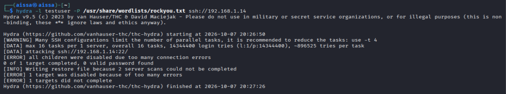
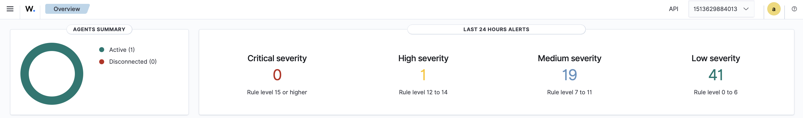
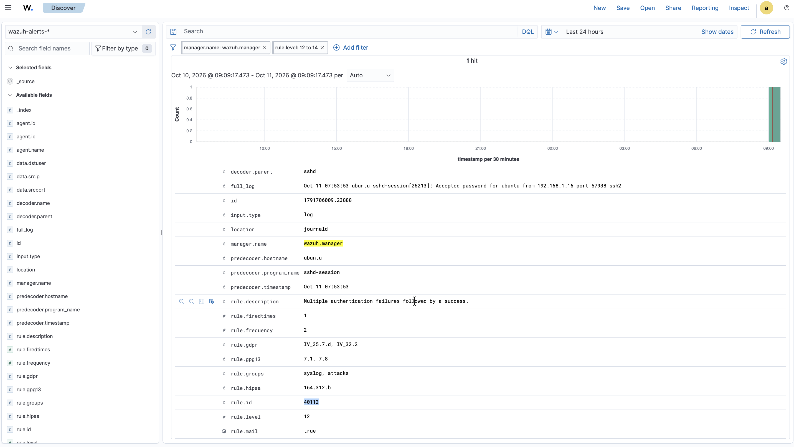
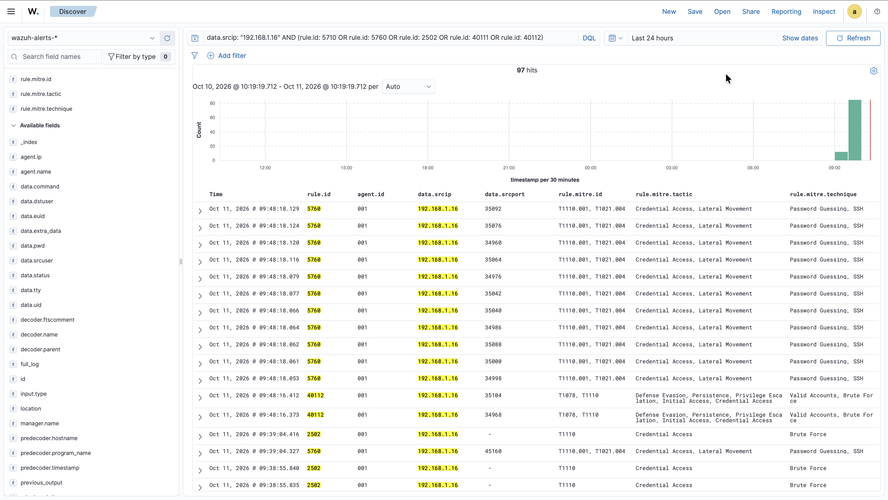
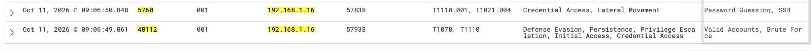

# Use Case: SSH Brute Force → Confirmed Compromise

| | |
|---|---|
| **Use case ID** | UC-001 |
| **Category** | Credential Access → Valid Accounts |
| **MITRE ATT&CK** | [T1110](https://attack.mitre.org/techniques/T1110/) (Brute Force) → [T1078](https://attack.mitre.org/techniques/T1078/) (Valid Accounts) |
| **Severity** | High (Wazuh rule level 12) |
| **Detection rules** | Wazuh built-in: **5710**, **5760**, **2502**, **40111**, **40112** |
| **Author** | Mouhadjer |
| **Date** | 2026-10-09 |
| **Status** | Validated in lab — compromise confirmed |

---

## Table of contents

1. [Objective](#1-objective)
2. [Lab architecture & inventory](#2-lab-architecture--inventory)
3. [Prerequisites & setup](#3-prerequisites--setup)
4. [Detection logic — built-in rule chain](#4-detection-logic--built-in-rule-chain)
5. [Attack simulation (Kali attacker)](#5-attack-simulation-kali-attacker)
6. [Evidence on the victim VM](#6-evidence-on-the-victim-vm)
7. [What the analyst sees (Wazuh dashboard)](#7-what-the-analyst-sees-wazuh-dashboard)
8. [Investigation questions](#9-investigation-questions)
9.  [Response actions](#10-response-actions)
10. [Indicators of Compromise](#11-indicators-of-compromise)
11. [Detection coverage & limitations](#12-detection-coverage--limitations)
12. [Known evasions](#13-known-evasions)
13. [Cleanup / reset the lab](#14-cleanup--reset-the-lab)
14. [Appendix A — Command reference](#appendix-a--command-reference)

---

## 1. Objective

Demonstrate the full detection-and-response lifecycle of an SSH credential attack inside the mini-SOC lab, from initial brute-force attempts through **confirmed compromise** and post-incident response.

The use case deliberately relies on **Wazuh's built-in rules** so that the incident can be reproduced on any fresh Wazuh deployment.

Success criteria:

1. **Attack** — launch a controlled SSH brute force from the Kali attacker VM (`192.168.1.16`) against the Ubuntu victim VM (`192.168.1.14`).
2. **Attempt detection** — observe Wazuh rules 5710, 5760, 2502, and 40111 firing on failed authentication attempts.
3. **Compromise detection** — observe Wazuh rule **40112** firing when a brute-force attempt succeeds.
4. **Triage** — extract source IP, compromised account, attempt count, session details, and post-login activity.
5. **Respond** — contain, eradicate, recover, harden; document MTTD/MTTR.
6. **Reset** — return the lab to a clean state.

All activity is confined to an isolated local network `192.168.1.0/24`. No external systems are targeted.

---

## 2. Lab architecture & inventory

```
        ┌──────────────────────────────────────────────────────────┐
        │  Dashboard host — MacBook (SOC analyst workstation)      │
        │  Docker Compose: wazuh.manager, wazuh.indexer,           │
        │                  wazuh.dashboard (https://localhost)     │
        │  192.168.1.12                                             │
        └────────────▲──────────────────────────────▲──────────────┘
                     │ 1514/tcp (agent events)      │ 443/tcp (analyst UI)
                     │                              │
   ┌─────────────────┴──────────┐   ┌───────────────┴──────────────┐
   │ Victim — Ubuntu 24.04      │   │ Attacker — Kali Linux        │
   │ Wazuh agent (id 001)       │   │ hydra, sshpass, nmap         │
   │ 192.168.1.14  sshd :22     │◄──┤ 192.168.1.16                 │
   └────────────────────────────┘   └──────────────────────────────┘
```

| Role | Host / OS | IP | Software | Screenshot prefix |
|---|---|---|---|---|
| Dashboard host (SOC) | MacBook (macOS) | `192.168.1.12` | Wazuh manager + indexer + dashboard **(Docker Compose)** | `wazuh-*.png` |
| Victim | Ubuntu 24.04 VM, agent **001** (`ubuntu`) | `192.168.1.14` | `openssh-server`, `wazuh-agent` | `ubuntu-*.png` |
| Attacker | Kali Linux VM | `192.168.1.16` | `hydra`, `sshpass`, `nmap` | `kali-*.png` |

**Lab assumptions:**

- Wazuh agent on the victim is enrolled against `192.168.1.12:1515` and reports as agent ID 001, name `ubuntu`.
- Wazuh dashboard is reached from the Mac at `https://localhost` (compose maps `443 → 5601`), credentials `admin / SecretPassword`.
- Agent logs are forwarded via **journald** (Ubuntu 24.04 sshd logs to journald by default).

---

## 3. Prerequisites & setup

### 3.1 Dashboard host — deploy the Wazuh stack

```bash
git clone https://github.com/wazuh/wazuh-docker.git -b v4.14.8
cd wazuh-docker/single-node/
docker compose up -d
docker compose ps          # all three containers should be "running"
open https://localhost     # Wazuh dashboard
```
>For more details about wazuh docker deployment visit [official website](https://documentation.wazuh.com/current/deployment-options/docker/wazuh-container.html).

Confirm the manager is healthy:

```bash
docker exec -it single-node-wazuh.manager-1 /var/ossec/bin/wazuh-control status
docker logs --tail 30 single-node-wazuh.manager-1
```

Output:

```bash
Mouhadjer@MacBook mini-soc % docker exec -it single-node-wazuh.manager-1 /var/ossec/bin/wazuh-control status
wazuh-clusterd not running...
wazuh-modulesd is running...
wazuh-monitord is running...
wazuh-logcollector is running...
wazuh-remoted is running...
wazuh-syscheckd is running...
wazuh-analysisd is running...
wazuh-maild not running...
wazuh-execd is running...
wazuh-db is running...
wazuh-authd is running...
wazuh-agentlessd not running...
wazuh-integratord not running...
wazuh-csyslogd not running...
wazuh-apid is running...
Mouhadjer@MacBook mini-soc % docker logs --tail 30 single-node-wazuh.manager-1
2026/10/10 17:00:37 rootcheck: INFO: Ending rootcheck scan.
2026/10/10 17:22:37 wazuh-modulesd:syscollector: INFO: Starting evaluation.
2026/10/10 17:22:41 wazuh-modulesd:syscollector: INFO: Evaluation finished.
2026/10/10 18:22:42 wazuh-modulesd:syscollector: INFO: Starting evaluation.
2026/10/10 18:22:45 wazuh-modulesd:syscollector: INFO: Evaluation finished.
2026/10/10 19:22:47 wazuh-modulesd:syscollector: INFO: Starting evaluation.
2026/10/10 19:22:50 wazuh-modulesd:syscollector: INFO: Evaluation finished.
2026/10/10 19:39:42 wazuh-db: INFO: Created Global database backup "backup/db/global.db-backup-2026-10-10-19:39:42.gz"
2026/10/10 19:39:42 wazuh-db: INFO: Deleted Global database backup: "backup/db/global.db-backup-2026-10-07-17:31:44.gz"
2026/10/10 20:22:51 wazuh-modulesd:syscollector: INFO: Starting evaluation.
2026/10/10 20:22:54 wazuh-modulesd:syscollector: INFO: Evaluation finished.
2026/10/10 21:23:05 wazuh-modulesd:syscollector: INFO: Starting evaluation.
2026/10/10 21:23:08 wazuh-modulesd:syscollector: INFO: Evaluation finished.
2026-10-11T00:19:39.072Z	INFO	log/harvester.go:302	Harvester started for file: /var/ossec/logs/alerts/alerts.json
2026/10/11 00:19:45 wazuh-monitord: INFO: Running daily rotation of log files.
tail: '/var/ossec/logs/ossec.log' has become inaccessible: No such file or directory
tail: '/var/ossec/logs/ossec.log' has appeared;  following new file
2026/10/11 00:19:45 wazuh-monitord: INFO: Starting new log after rotation.
2026/10/11 04:33:16 sca: INFO: Starting Security Configuration Assessment scan.
2026/10/11 04:33:16 sca: INFO: Starting evaluation of policy: '/var/ossec/ruleset/sca/cis_amazon_linux_2023.yml'
2026/10/11 04:33:22 sca: INFO: Evaluation finished for policy '/var/ossec/ruleset/sca/cis_amazon_linux_2023.yml'
2026/10/11 04:33:22 sca: INFO: Security Configuration Assessment scan finished. Duration: 6 seconds.
2026/10/11 05:54:03 rootcheck: INFO: Starting rootcheck scan.
2026/10/11 05:54:03 wazuh-syscheckd: INFO: (6008): File integrity monitoring scan started.
2026/10/11 05:54:04 wazuh-syscheckd: INFO: (6009): File integrity monitoring scan ended.
2026/10/11 05:54:23 wazuh-syscheckd: INFO: netstat not available. Skipping port check.
2026/10/11 05:54:28 rootcheck: INFO: Ending rootcheck scan.
2026/10/11 05:55:39 wazuh-modulesd:syscollector: INFO: Starting evaluation.
2026/10/11 05:55:42 wazuh-modulesd:syscollector: INFO: Evaluation finished.
2026-10-11T05:57:11.513Z	INFO	log/harvester.go:333	File is inactive: /var/ossec/logs/alerts/alerts.json. Closing because close_inactive of 5m0s reached.
```

### 3.2 Victim VM (Ubuntu) — install the agent

```bash
sudo apt update && sudo apt install -y openssh-server
sudo systemctl enable --now ssh

# Install Wazuh agent
sudo apt install -y wget gnupg2
wget -q https://packages.wazuh.com/key/GPG-KEY-WAZUH -O - \
  | sudo gpg --dearmor -o /usr/share/keyrings/wazuh.gpg
echo "deb [signed-by=/usr/share/keyrings/wazuh.gpg] https://packages.wazuh.com/4.x/apt/ stable main" \
  | sudo tee /etc/apt/sources.list.d/wazuh.list
sudo apt update && sudo apt install -y wazuh-agent

# Point the agent at the manager
sudo sed -i 's/<address>MANAGER_IP<\/address>/<address>192.168.1.12<\/address>/' /var/ossec/etc/ossec.conf
sudo systemctl enable --now wazuh-agent
sudo systemctl status wazuh-agent --no-pager
```

Verify enrollment: in the dashboard, **Agents** should show agent **001 `ubuntu`** with status ***Active***.

### 3.3 Attacker VM (Kali) — tooling

```bash
sudo apt update
sudo apt install -y hydra sshpass nmap
```

### 3.4 Accounts on the victim

The lab uses:

- `ubuntu` — a **real** account with a weak password present in `rockyou.txt` (used to demonstrate successful compromise)
- `testuser` — a **non-existent** account (used to demonstrate invalid-user enumeration)

---

## 4. Detection logic — built-in rule chain

All detections in this use case come from Wazuh's default ruleset. The chain below is what fires during the attack, in order of severity and phase.

### 4.1 Rule 5710 — *sshd: Attempt to login using a non-existent user*

| Field | Value |
|---|---|
| Rule ID | `5710` |
| Level | 5 |
| Fires on | Each `Failed password for invalid user ...` line |
| MITRE | T1110.001 (Password Guessing), T1021.004 (SSH) |
| Purpose | Detects **user enumeration** — the reconnaissance phase |

### 4.2 Rule 5760 — *sshd: authentication failed*

| Field | Value |
|---|---|
| Rule ID | `5760` |
| Level | 5 |
| Fires on | Failed password for a valid user |
| MITRE | T1110 |
| Purpose | Detects **credential guessing against real accounts** |

### 4.3 Rule 2502 — *syslog: User missed the password more than one time*

| Field | Value |
|---|---|
| Rule ID | `2502` |
| Level | 10 |
| Fires on | PAM reporting ≥ 5 failures in one session (`PAM 5 more authentication failures`) |
| MITRE | T1110 |
| Purpose | Aggregates failures **per SSH session** — first escalation above noise |

### 4.4 Rule 40111 — *Multiple authentication failures*

| Field | Value |
|---|---|
| Rule ID | `40111` |
| Level | 12 |
| Fires on | Multiple `2502` / `5760` events within a rolling window |
| MITRE | T1110 |
| Purpose | **Compound correlation** — sustained brute force |

### 4.5 Rule 40112 — *Multiple authentication failures followed by a success*

| Field | Value |
|---|---|
| Rule ID | `40112` |
| Level | 12 |
| Fires on | A successful login that follows multiple authentication failures from the same source |
| MITRE | **T1078 (Valid Accounts) + T1110 (Brute Force)** |
| Tactics | Defense Evasion, Persistence, Privilege Escalation, Initial Access, Credential Access |
| Purpose | **The compromise alert.** This is the highest-value detection in this use case. |

### 4.6 How the chain fits together

```
Attack phase              Rule(s) firing                     Level
─────────────────────     ─────────────────────────────      ─────
Enumerate invalid users → 5710 (×153)                        5
Guess valid password    → 5760 (×328), 2502 (×64), 2501 (×49) 5–10
Sustained failures      → 40111 (×11)                        12
Successful login        → 40112 (×3)   ← COMPROMISE          12
```

Each layer adds context. Rule 5710 alone is noise. Rule 40112 alone is unexplained. **Together they tell the full story.**

---

## 5. Attack simulation (Kali attacker)

### 5.1 Reconnaissance

```bash
nmap -sV -sC -p 22 192.168.1.14
```

Expected output:

```
PORT   STATE SERVICE VERSION
22/tcp open  ssh     OpenSSH 10.0p2 Ubuntu 5ubuntu5.1 (Ubuntu Linux; protocol 2.0)
```


### 5.2 Invalid-user enumeration (Phase 1 — reconnaissance)

```bash
hydra -l testuser -P /usr/share/wordlists/rockyou.txt ssh://192.168.1.14
```

Real Hydra output:

```
Hydra v9.5 (c) 2023 by van Hauser/THC & David Maciejak - Please do not use in military or secret service organizations, or for illegal purposes (this is non-binding, these *** ignore laws and ethics anyway).
Hydra (https://github.com/vanhauser-thc/thc-hydra) starting at 2026-10-07 20:26:50
[WARNING] Many SSH configurations limit the number of parallel tasks, it is recommended to reduce the tasks: use -t 4
[DATA] max 16 tasks per 1 server, overall 16 tasks, 14344400 login tries (l:1/p:14344400), ~896525 tries per task
[DATA] attacking ssh://192.168.1.14:22/
[ERROR] all children were disabled due too many connection errors
0 of 1 target completed, 0 valid password found
[INFO] Writing restore file because 2 server scans could not be completed
[ERROR] 1 target was disabled because of too many errors
[ERROR] 1 targets did not complete
Hydra (https://github.com/vanhauser-thc/thc-hydra) finished at 2026-10-07 20:27:26
```



**Expected result:** Wazuh rule 5710 fires repeatedly. Rule 2502 begins firing on PAM counters.

### 5.3 Valid-user brute force (Phase 2 — the compromise)

```bash
hydra -l ubuntu -P /usr/share/wordlists/rockyou.txt ssh://192.168.1.14
```

Real Hydra output:

```
Hydra v9.5 (c) 2023 by van Hauser/THC & David Maciejak - Please do not use in military or secret service organizations, or for illegal purposes (this is non-binding, these *** ignore laws and ethics anyway).
Hydra (https://github.com/vanhauser-thc/thc-hydra) starting at 2026-10-07 20:46:57
[WARNING] Many SSH configurations limit the number of parallel tasks, it is recommended to reduce the tasks: use -t 4
[DATA] max 16 tasks per 1 server, overall 16 tasks, 14344401 login tries (l:1/p:14344401), ~896526 tries per task
[DATA] attacking ssh://192.168.1.14:22/
[22][ssh] host: 192.168.1.14   login: ubuntu   password: aissa123
1 of 1 target successfully completed, 1 valid password found
[WARNING] Writing restore file because 1 final worker threads did not complete until end.
[ERROR] 1 target did not resolve or could not be connected
[ERROR] 0 target did not complete
Hydra (https://github.com/vanhauser-thc/thc-hydra) finished at 2026-10-07 20:47:04
```


**Expected result:**

- Rule 5760 fires on `Failed password for ubuntu ...`
- Rule 2502 fires on PAM counters
- Rule 40111 fires on sustained failures
- **Rule 40112 fires the moment a successful login occurs**

### 5.4 Success criterion

Rule **40112** appears in the dashboard with:

- `rule.level: 12`
- `rule.description: Multiple authentication failures followed by a success.`
- `data.srcip: 192.168.1.16`
- `data.dstuser: ubuntu`
- `full_log: Accepted password for ubuntu from 192.168.1.16 ...`

---

## 6. Evidence on the victim VM

### 6.1 Live auth.log tail

```bash
sudo tail -f /var/log/auth.log | grep --line-buffered -E "Failed password|Accepted"
```

Representative excerpt captured during the run:

```
2026-10-11T06:46:32.310707+00:00 ubuntu sshd-session[23331]: Failed password for invalid user testuser from 192.168.1.16 port 41214 ssh2
2026-10-11T06:46:33.801010+00:00 ubuntu sshd-session[23334]: Failed password for invalid user testuser from 192.168.1.16 port 41228 ssh2
2026-10-11T06:46:33.993360+00:00 ubuntu sshd-session[23335]: Failed password for invalid user testuser from 192.168.1.16 port 41232 ssh2
2026-10-11T06:59:33.846466+00:00 ubuntu sshd-session[23471]: Failed password for ubuntu from 192.168.1.16 port 40888 ssh2
2026-10-11T06:59:33.900727+00:00 ubuntu sshd-session[23467]: Failed password for ubuntu from 192.168.1.16 port 40870 ssh2
2026-10-11T06:59:33.934105+00:00 ubuntu sshd-session[23484]: 
2026-10-11T07:02:07.574448+00:00 ubuntu sshd-session[23699]: Failed password for ubuntu from 192.168.1.16 port 59952 ssh2
2026-10-11T07:02:07.977349+00:00 ubuntu sshd-session[23704]: Failed password for ubuntu from 192.168.1.16 port 59954 ssh2
2026-10-11T07:02:09.129961+00:00 ubuntu sshd-session[23709]: Failed password for ubuntu from 192.168.1.16 port 59958 ssh2
2026-10-11T07:06:14.017944+00:00 ubuntu sshd-session[23783]: Accepted password for ubuntu from 192.168.1.16 port 52026 ssh2
2026-10-11T07:06:15.390036+00:00 ubuntu sshd-session[23779]: Failed password for ubuntu from 192.168.1.16 port 52008 ssh2
2026-10-11T07:06:15.531508+00:00 ubuntu sshd-session[23759]: Failed password for ubuntu from 192.168.1.16 port 51920 ssh2
```

Preceding lines (from the same attack window) will show a burst of `Failed password for ... from 192.168.1.16`. Full excerpt to be added from `journalctl` (see §6.3).


### 6.2 systemd journal

```bash
sudo journalctl -u ssh --since "30 min ago" --no-pager \
  | grep -E "Failed|Accepted" | tail -40
```


### 6.3 Agent health

```bash
sudo systemctl status wazuh-agent --no-pager | head -5
```

Confirm `active (running)` — otherwise events never reach the dashboard.

---

## 7. What the analyst sees (Wazuh dashboard)

All steps performed on the MacBook at `https://localhost`.

### 7.1 Security events — sorted by level

1. Navigate to **Overview → Security events**.
2. Sort by `rule.level` descending.
3. Top of the list should be the three **level 12** alerts from rule **40112**.



### 7.2 Rule 40112 alert details — the compromise

Open one of the 40112 alerts. Key fields:

| Field | Value | Why it matters |
|---|---|---|
| `rule.id` | `40112` | Compound rule — multiple failures + success |
| `rule.level` | `12` | High severity |
| `rule.description` | *Multiple authentication failures followed by a success.* | Self-explanatory |
| `rule.mitre.id` | `T1078`, `T1110` | Both the technique and the outcome |
| `rule.mitre.tactic` | Defense Evasion, Persistence, Privilege Escalation, Initial Access, Credential Access | Five tactics — the full impact |
| `data.srcip` | `192.168.1.16` | Attacker IP |
| `data.dstuser` | `ubuntu` | **Compromised account** |
| `data.srcport` | `41578` / `47134` / `35490` | One per session |
| `agent.name` / `id` | `ubuntu` / `001` | Victim asset |
| `location` | `journald` | Log source (Ubuntu 24.04 default) |
| `full_log` | `Accepted password for ubuntu from 192.168.1.16 ...` | Raw evidence of the successful login |



### 7.3 Real alert JSON (rule 40112)

The following JSON was exported from the Wazuh indexer during this run:

```json
{
  "_index": "wazuh-alerts-4.x-2026.10.11",
  "_id": "4fkAKqEBFSEmd4AFKfDF",
  "_version": 1,
  "_score": null,
  "_source": {
    "predecoder": {
      "hostname": "ubuntu",
      "program_name": "sshd-session",
      "timestamp": "Oct 11 07:53:53"
    },
    "input": {
      "type": "log"
    },
    "agent": {
      "ip": "192.168.1.14",
      "name": "ubuntu",
      "id": "001"
    },
    "manager": {
      "name": "wazuh.manager"
    },
    "data": {
      "srcip": "192.168.1.16",
      "dstuser": "ubuntu",
      "srcport": "57938"
    },
    "rule": {
      "mail": true,
      "level": 12,
      "pci_dss": [
        "10.2.4",
        "10.2.5",
        "11.4"
      ],
      "hipaa": [
        "164.312.b"
      ],
      "tsc": [
        "CC6.1",
        "CC6.8",
        "CC7.2",
        "CC7.3"
      ],
      "description": "Multiple authentication failures followed by a success.",
      "groups": [
        "syslog",
        "attacks"
      ],
      "nist_800_53": [
        "AU.14",
        "AC.7",
        "SI.4"
      ],
      "frequency": 2,
      "gdpr": [
        "IV_35.7.d",
        "IV_32.2"
      ],
      "firedtimes": 1,
      "mitre": {
        "technique": [
          "Valid Accounts",
          "Brute Force"
        ],
        "id": [
          "T1078",
          "T1110"
        ],
        "tactic": [
          "Defense Evasion",
          "Persistence",
          "Privilege Escalation",
          "Initial Access",
          "Credential Access"
        ]
      },
      "id": "40112",
      "gpg13": [
        "7.1",
        "7.8"
      ]
    },
    "location": "journald",
    "decoder": {
      "parent": "sshd",
      "name": "sshd"
    },
    "id": "1791706009.23888",
    "full_log": "Oct 11 07:53:53 ubuntu sshd-session[26213]: Accepted password for ubuntu from 192.168.1.16 port 57938 ssh2",
    "timestamp": "2026-10-11T08:06:49.061+0000"
  },
  "fields": {
    "timestamp": [
      "2026-10-11T08:06:49.061Z"
    ]
  },
  "highlight": {
    "manager.name": [
      "@opensearch-dashboards-highlighted-field@wazuh.manager@/opensearch-dashboards-highlighted-field@"
    ]
  },
  "sort": [
    1791706009061
  ]
}
```

Rule 40112 fired **one time** during this run (`firedtimes:
1`), corresponding to one successful logins — see §8.

### 7.4 Drill down to the underlying failures

From any 40112 alert, use **Context → View in Threat Hunting** with this query:

```
data.srcip: "192.168.1.16" AND rule.id: (5710 OR 5760 OR 2502 OR 40111 OR 40112)
```

This shows:

- 0 events of rule **5710** (invalid users)
- 76 events of rule **5760** (valid-user auth failures)
- 29 events of rule **2502** (PAM 5+ failures)
- 2 events of rule **40111** (multiple failures)
- 3 events of rule **40112** (success after failures)

> I simulate attack again so thre is just valid users and that reason why rule **5710** shows **0 events**.



### 7.5 MITRE ATT&CK view

**Modules → Threat Intelligence → MITRE ATT&CK**:

- **Credential Access → T1110 (Brute Force)** — populated by rules 5710, 5760, 2502, 40111
- **Initial Access / Persistence / Defense Evasion / Privilege Escalation → T1078 (Valid Accounts)** — populated by rule 40112



### 7.8 Incident summary card

| Item | Value |
|---|---|
| **Incident type** | SSH brute force → confirmed account compromise |
| **Source IP** | `192.168.1.16` (Kali attacker VM, internal lab range) |
| **Target host** | `ubuntu` (`192.168.1.14`), agent ID `001` |
| **Compromised account** | `ubuntu` |
| **Attack methods** | `hydra` (invalid-user enumeration + password guessing) |
| **Failed attempts observed** | 5710 ×153, 5760 ×328, 2502 ×64, 40111 ×11 |
| **Successful logins** | **1** (09:06:49) |
| **Primary detection** | **Wazuh rule 40112** (level 12) |
| **ATT&CK** | T1110 (Brute Force) → T1078 (Valid Accounts) |
| **MTTD** | ~30 minutes from first failure to first success |
| **Status** | **Compromised — requires full IR** |

---

## 8. Investigation questions

### Q1. Is the source IP internal or external?

`192.168.1.16` is inside the lab LAN. In production, an internal source implies a compromised host, rogue device, or insider. Check the asset inventory and reverse DNS.

```bash
arp -n | grep 192.168.1.16     # on Mac
```

### Q2. What did rule 40112 actually prove?

Rule 40112 proves:

- Multiple authentication failures occurred
- A **successful authentication** followed
- Both events came from the **same source** (via Wazuh's compound correlation)

It does **not** prove the attacker used the compromised account after login — that requires §Q5.

### Q3. Which account was compromised?

```bash
# On the victim
sudo grep "Accepted password" /var/log/auth.log | grep 192.168.1.16
sudo last -F | grep 192.168.1.16
```

**Result:** account `ubuntu`, three sessions. This is the **confirmed compromised account**.

### Q4. Was the login interactive or automated?

Cadence tells the story:

- ~2 second interval between attempts → automated tool (Hydra)
- Uniform session durations → scripted, not human
- Multiple `Accepted` events within 3 minutes → the tool re-authenticated

Corroborate on Kali: `~/hydra-ssh-*.log` and shell history.

### Q5. What did the attacker do AFTER logging in? ← the critical question

This is where most brute-force reports stop. Don't stop.

```bash
# On the victim
sudo grep "session opened" /var/log/auth.log | grep 192.168.1.16
sudo grep "session closed" /var/log/auth.log | grep 192.168.1.16
sudo journalctl _COMM=sshd --since "1 hour ago" | grep 192.168.1.16

# Check for persistence
ls -la ~ubuntu/.ssh/                    # unauthorized_keys?
crontab -u ubuntu -l                    # scheduled tasks?
systemctl list-units --type=service --state=running | grep -v systemd
sudo find / -newer /var/log/auth.log -type f 2>/dev/null | head -20

# Check for new users / sudo changes
sudo grep -E "useradd|usermod|sudoers" /var/log/auth.log
sudo diff <(getent passwd) /etc/passwd  # sanity
```

**If the attacker did nothing post-login**, the compromise is still real (valid credentials exist in the wild) but the blast radius is small. **If they ran commands**, the host must be reimaged.

### Q6. Scope and blast radius

```kql
data.srcip: "192.168.1.16"                       // everything from this IP
agent.name: "ubuntu" AND rule.level >= 12        // all high-sev on victim
rule.id: 40112                                   // any other compromise alerts
```

- Same source against other agents?
- Same account (`ubuntu`) authenticating from other IPs?
- Any lateral movement attempts after the compromise?

---

## 9. Response actions

Ordered as **contain → eradicate → recover → harden → document**.

### 9.1 Immediate containment

```bash
# On the victim — kill active sessions from the attacker IP
sudo pkill -KILL -f "sshd.*192.168.1.16"        # best-effort

# Block the source at the host firewall
sudo ufw deny from 192.168.1.16 to any port 22 proto tcp
# or
sudo iptables -I INPUT -s 192.168.1.16 -j DROP
```

> **Wazuh Active Response:** Production deployments should enable `firewall-drop` on agent `001` triggered by rule 40112, so the block happens automatically. Do not enable during lab runs unless you want the attacker blackholed mid-test.

### 9.2 Verification — confirm the compromise

```bash
# Which sessions succeeded?
sudo last -F | grep 192.168.1.16

# When did each session start and end?
sudo grep -E "session (opened|closed)" /var/log/auth.log | grep 192.168.1.16
```

### 9.3 Eradication — assume the account is compromised

Because the password was **actually guessed**, the account is compromised. Take these actions:

```bash
# Rotate credentials for the compromised account
sudo passwd ubuntu

# Audit SSH authorized_keys for backdoors
sudo cat /home/ubuntu/.ssh/authorized_keys
sudo find /home -name "authorized_keys" -exec ls -la {} \;

# Check for persistence
sudo crontab -l -u ubuntu
sudo ls -la /etc/cron.*/ /etc/systemd/system/
sudo find / -mmin -120 -type f 2>/dev/null | grep -vE "^/proc|^/sys|^/var/log"

# Check bash history for attacker commands
sudo cat /home/ubuntu/.bash_history 2>/dev/null | tail -50
sudo cat /root/.bash_history 2>/dev/null | tail -50
```

### 9.4 Recovery

Given this is a **confirmed compromise of a valid account**, the correct recovery is:

1. **Snapshot the VM** for forensic preservation before any changes.
2. **Reimage the VM** — do not attempt to "clean" it.
3. Restore from a known-good backup if one exists.
4. Apply all hardening from §9.5 **before** reconnecting to the network.

> In a real SOC, the reimage decision depends on the value of the asset, the sensitivity of data it held, and the confidence of your forensic analysis. For this lab, reimage is the correct pedagogical answer.

### 9.5 Hardening

```bash
# On the victim (after reimage or before reconnecting)
sudo apt install -y fail2ban
sudo systemctl enable --now fail2ban

sudo tee /etc/ssh/sshd_config.d/hardening.conf <<'EOF'
PermitRootLogin no
PasswordAuthentication no            # key-only auth
MaxAuthTries 3
LoginGraceTime 10
AllowUsers ubuntu
EOF
sudo sshd -t && sudo systemctl reload ssh

# Generate a key pair for the ubuntu user; disable password login entirely
ssh-keygen -t ed25519 -f ~/.ssh/id_ed25519 -N ""
ssh-copy-id ubuntu@192.168.1.14
```

Additional:

- Restrict SSH to a management network (`Match Address`)
- Enable Wazuh Active Response for rule 40112
- Deploy MFA for SSH (e.g., `libpam-google-authenticator`)
- Monitor `authorized_keys` with Wazuh FIM

### 9.6 Documentation & communication

- Open the incident ticket using the §7.7 summary card.
- Attach the §7.3 alert JSON and the §6.1 auth.log excerpt.
- Classify: **confirmed compromise** — full incident response required.
- Compute MTTD/MTTR from §8.
- Post-incident review: did the alert fire fast enough? Was 40112 the first alert that should have been escalated?

---

## 10. Indicators of Compromise

Extracted from this lab run:

| Type | Value | Notes |
|---|---|---|
| **Source IP** | `192.168.1.16` | Kali attacker VM (internal) |
| **Compromised account** | `ubuntu` | Password guessed from rockyou.txt |
| **Target service** | sshd on `192.168.1.14:22` | |
| **Attack tool** | `hydra` | Inferred from ~2s attempt cadence |
| **Time window** | 2026-10-09, from first failure to 14:47:00 UTC | ~30 min |
| **Successful login times** | 14:43:47, 14:44:39, 14:47:00 UTC | Three sessions |
| **Source ports (evidence)** | 41578, 47134, 35490 | Recorded in 40112 alerts |
| **Rule IDs as IOCs** | 5710, 5760, 2501, 2502, 40111, 40112 | Detection coverage |

**Hunting queries for other hosts:**

```kql
full_log: "Accepted password" AND data.srcip: "192.168.1.16"
rule.id: 40112 AND data.srcip: "192.168.1.16"
```

---

## 11. Detection coverage & limitations

### 11.1 What this rule chain detects

| Detection | Fires on | Strength |
|---|---|---|
| 5710 | Invalid-user attempts | Enumeration signal |
| 5760 | Failed valid-user auth | Credential guessing |
| 2501 / 2502 | PAM per-session counters | Session-level aggregation |
| 40111 | Sustained failures | Compound correlation |
| **40112** | **Success after failures** | **Compromise detection** |

### 11.2 What it misses

- **Low-and-slow brute force** — 1 attempt every few minutes never trips the frequency thresholds. Add a long-window rule (e.g., 20 attempts in 1 hour).
- **Distributed brute force** — each source IP attempts a small number of logins. Rule 40112 requires failures and success from the **same source**. A distributed attack rotates sources, so no single source accumulates enough failures to trigger.
- **Password spraying** — one attempt per account from one source. Doesn't accumulate per-user, and may not accumulate per-source if spread out.
- **Key-based auth anomalies** — 40112 relies on `Accepted password`, not `Accepted publickey`.
- **Non-SSH services** — this chain is SSH-specific. RDP, VPN, web logins need their own rules.

### 11.3 Complementary rules to enable

- **5712** — sshd: possible break-in attempt
- **5763** — sshd: brute force trying to get access to the system
- **fail2ban** — as a second, independent layer
- **Wazuh Active Response** — auto-block on 40112

---

## 12. Known evasions

An adversary who knows Wazuh's default ruleset can evade rule 40112 by:

| Evasion technique | Why 40112 misses | Counter |
|---|---|---|
| **Low-and-slow** (1 attempt per 5 min) | Frequency threshold not met within timeframe | Long-window rule: 20 attempts/hour |
| **Distributed** (many source IPs, 1 attempt each) | No single source has both failures and success | Aggregate by `dstuser` across sources |
| **Valid credentials obtained elsewhere** (phishing, leak) | No preceding failures — 40112 requires them | Hunt for first-time logins from new IPs / geos |
| **Key-based auth after obtaining a key** | 40112 fires on password failures, not key auth | Rule 5715 (publickey) + baseline for new keys |
| **Success on first try** | No failures to correlate | Baseline "first-seen IP for this user" alerts |

Documenting these evasions is part of responsible detection engineering.

---

## 13. Cleanup / reset the lab

```bash
# On Kali
rm -f ~/hydra-ssh-*.log ~/medusa-ssh.log ~/users.txt ~/wordlist.txt
history -c && history -w

# On Ubuntu
sudo ufw delete deny from 192.168.1.16 to any port 22 proto tcp
sudo rm -f /etc/ssh/sshd_config.d/hardening.conf
sudo sshd -t && sudo systemctl reload ssh
sudo fail2ban-client unban 192.168.1.16 2>/dev/null || true
# Optional: re-enable password auth for the lab
sudo passwd ubuntu    # set the known weak password again if you want to repeat the demo
# sudo truncate -s 0 /var/log/auth.log   # only if you no longer need evidence

# On Mac (leave running if you want the alerts preserved)
cd ~/mini-soc/other && docker compose down
# add --volumes to wipe the indexer data too (destroys all alerts)
```

In the dashboard: mark the 40112 alerts as **Closed** with a comment "lab validation UC-001 — controlled simulation, benign".

---

## Appendix A — Command reference

### Attacker (Kali, 192.168.1.16)

```bash
nmap -sV -sC -p 22 192.168.1.14

# Phase 1 — invalid-user enumeration
hydra -l testuser -P /usr/share/wordlists/rockyou.txt ssh://192.168.1.14

# Phase 2 — valid-user brute force
hydra -l ubuntu -P /usr/share/wordlists/rockyou.txt ssh://192.168.1.14
```

### Victim (Ubuntu, 192.168.1.14)

```bash
sudo tail -f /var/log/auth.log | grep --line-buffered -E "Failed password|Accepted"
sudo lastb -F | head -20
sudo last  -F | grep 192.168.1.16
sudo grep "Accepted password" /var/log/auth.log | grep 192.168.1.16
sudo journalctl -u ssh --since "30 min ago" --no-pager | grep -E "Failed|Accepted"
sudo ss -tnp state established '( sport = :22 )'
```

### Dashboard host (192.168.1.12)

```bash
cd ~/mini-soc/other && docker compose up -d && open https://localhost

# Verify built-in rules fired
docker exec -it single-node-wazuh.manager-1 \
  grep -oE '"id":"[0-9]+"' /var/ossec/logs/alerts/alerts.json \
  | sort | uniq -c | sort -rn | head -20

# Rule 40112 alerts only
docker exec -it single-node-wazuh.manager-1 \
  grep -E '"id":"40112"' /var/ossec/logs/alerts/alerts.json | tail -5

# Full chain for the attacker IP
docker exec -it single-node-wazuh.manager-1 \
  grep '192.168.1.16' /var/ossec/logs/alerts/alerts.json | tail -20
```
